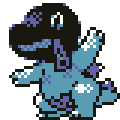

# 158 BONDILE

[← 157 INFERNATUS](157_INFERNATUS.md) · [Pokédex](../pokedex.md) · [159 GAGOGO →](159_GAGOGO.md)

  

front · shiny · battle animation

animation frames (base + 3)

 party icon

 palette: normal · shiny

| | |
|---|---|
| Type | SEX |
| HP | 50 `██████` |
| Attack | 65 `████████` |
| Defense | 64 `████████` |
| Sp. Atk | 44 `██████` |
| Sp. Def | 48 `██████` |
| Speed | 43 `█████` |
| Total | 314 |
| Catch rate | 45 |
| Base exp | 66 |
| Gender | 12.5% female |
| Growth | Medium Slow |
