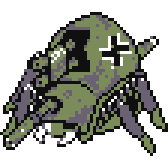
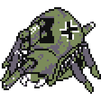

# 168 NAZITANK

**MILITARY / MEDICAL** · [← 167 NAZETTO](167_NAZETTO.md) · [Pokédex](../pokedex.md) · [169 TRIZOM →](169_TRIZOM.md)

<table><tr><th>Front</th><th>Shiny</th><th>Animated</th><th>Animated shiny</th></tr><tr><td align="center" valign="bottom"></td><td align="center" valign="bottom"></td><td align="center" valign="bottom"></td><td align="center" valign="bottom"></td></tr></table>

<table><tr><td valign="top"><table><tr><th colspan="3">Base stats</th></tr><tr><td>HP</td><td align="right">70</td><td>▇▇▇▇▇▇</td></tr><tr><td>Attack</td><td align="right">90</td><td>▇▇▇▇▇▇▇▇</td></tr><tr><td>Defense</td><td align="right">70</td><td>▇▇▇▇▇▇</td></tr><tr><td>Sp. Atk</td><td align="right">60</td><td>▇▇▇▇▇</td></tr><tr><td>Sp. Def</td><td align="right">60</td><td>▇▇▇▇▇</td></tr><tr><td>Speed</td><td align="right">40</td><td>▇▇▇</td></tr><tr><td><b>Total</b></td><td align="right"><b>390</b></td><td></td></tr></table></td><td valign="top"><table><tr><td>Catch rate</td><td>90</td></tr><tr><td>Base exp</td><td>134</td></tr><tr><td>Gender</td><td>50% female</td></tr><tr><td>Growth</td><td>Fast</td></tr></table>  party icon  palette: normal · shiny</td></tr></table>

**Animation frames** (base + 3)

## Pokédex

**LONG LEG** · 3'07" · 74.0 lb

> Rather than mak- ing a nest in one specific spot, it wanders in search of food after darkness falls.

## Evolution

Evolves from [NAZETTO](167_NAZETTO.md) (level 22)
