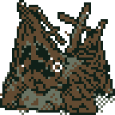
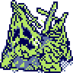
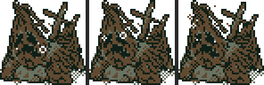

# 170 RELICTOU

**SEX / NUCLEAR** · [← 169 TRIZOM](169_TRIZOM.md) · [Pokédex](../pokedex.md) · [171 SOVIETO →](171_SOVIETO.md)

<table><tr><th>Front</th><th>Shiny</th><th>Animated</th><th>Animated shiny</th><th>Back</th></tr><tr><td align="center" valign="bottom"></td><td align="center" valign="bottom"></td><td align="center" valign="bottom"></td><td align="center" valign="bottom"></td><td align="center" valign="bottom"></td></tr></table>

Back sprite unchanged from Pokémon Crystal.

Plays every frame evenly; the game's own script for it is incomplete in v0.1.0.

<table><tr><td valign="top"><table><tr><th colspan="3">Base stats</th></tr><tr><td>HP</td><td align="right">75</td><td>▇▇▇▇▇▇</td></tr><tr><td>Attack</td><td align="right">38</td><td>▇▇▇</td></tr><tr><td>Defense</td><td align="right">38</td><td>▇▇▇</td></tr><tr><td>Sp. Atk</td><td align="right">56</td><td>▇▇▇▇▇</td></tr><tr><td>Sp. Def</td><td align="right">56</td><td>▇▇▇▇▇</td></tr><tr><td>Speed</td><td align="right">67</td><td>▇▇▇▇▇▇</td></tr><tr><td><b>Total</b></td><td align="right"><b>330</b></td><td></td></tr></table></td><td valign="top"><table><tr><td>Catch rate</td><td>190</td></tr><tr><td>Base exp</td><td>90</td></tr><tr><td>Gender</td><td>50% female</td></tr><tr><td>Growth</td><td>Slow</td></tr></table>  party icon  palette: normal · shiny</td></tr></table>

**Animation frames** (base + 2)

## Pokédex

**ANGLER** · 1'08" · 26.0 lb

> Its antennae, whi- ch evolved from a fin, have both po- sitive and neg- ative charges flo- wing through them.

Pokédex text unchanged from Pokémon Crystal.

## Evolution

Evolves into [SOVIETO](171_SOVIETO.md) (level 27)

## Moves

| Level | Move | Type | Power | Accuracy | PP |
|--:|---|---|--:|--:|--:|
| 1 | SALIVA | SEX | 20 | 100% | 30 |
| 1 | THUNDER WAVE | NUCLEAR | — | 100% | 20 |
| 5 | SUPERSONIC | MUTANT | — | 55% | 20 |
| 13 | FLAIL | MUTANT | — | 100% | 15 |
| 17 | PISS BOMB | SEX | 40 | 100% | 25 |
| 25 | SPARK | NUCLEAR | 65 | 100% | 20 |
| 29 | CONFUSE RAY | DEATH | — | 100% | 10 |
| 37 | TAKE DOWN | MUTANT | 90 | 85% | 20 |
| 41 | MEGA SQUIRT | SEX | 120 | 80% | 5 |

## Wild

Not in any wild encounter table.
