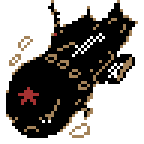
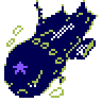
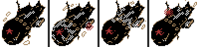

# 171 SOVIETO

**DEATH / NUCLEAR** · [← 170 RELICTOU](170_RELICTOU.md) · [Pokédex](../pokedex.md) · [172 BALBAC →](172_BALBAC.md)

<table><tr><th>Front</th><th>Shiny</th><th>Animated</th><th>Animated shiny</th></tr><tr><td align="center" valign="bottom"></td><td align="center" valign="bottom"></td><td align="center" valign="bottom"></td><td align="center" valign="bottom"></td></tr></table>

<table><tr><td valign="top"><table><tr><th colspan="3">Base stats</th></tr><tr><td>HP</td><td align="right">125</td><td>▇▇▇▇▇▇▇▇▇▇</td></tr><tr><td>Attack</td><td align="right">58</td><td>▇▇▇▇▇</td></tr><tr><td>Defense</td><td align="right">58</td><td>▇▇▇▇▇</td></tr><tr><td>Sp. Atk</td><td align="right">76</td><td>▇▇▇▇▇▇</td></tr><tr><td>Sp. Def</td><td align="right">76</td><td>▇▇▇▇▇▇</td></tr><tr><td>Speed</td><td align="right">67</td><td>▇▇▇▇▇▇</td></tr><tr><td><b>Total</b></td><td align="right"><b>460</b></td><td></td></tr></table></td><td valign="top"><table><tr><td>Catch rate</td><td>75</td></tr><tr><td>Base exp</td><td>156</td></tr><tr><td>Gender</td><td>50% female</td></tr><tr><td>Growth</td><td>Slow</td></tr></table>  party icon  palette: normal · shiny</td></tr></table>

**Animation frames** (base + 3)

## Pokédex

**URSS** · 3'11" · 50.0 lb

> Ideas are more powerful than guns We would not let our enemies have guns, why should we let have ideas.

## Evolution

Evolves from [RELICTOU](170_RELICTOU.md) (level 27)
