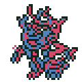

# 175 VENOSO

**MUTANT** · [← 174 RETINOL](174_RETINOL.md) · [Pokédex](../pokedex.md) · [176 VENESCO →](176_VENESCO.md)

<table><tr><th>Front</th><th>Shiny</th><th>Animated</th><th>Animated shiny</th><th>Back</th></tr><tr><td align="center" valign="bottom"></td><td align="center" valign="bottom"></td><td align="center" valign="bottom"></td><td align="center" valign="bottom"></td><td align="center" valign="bottom"></td></tr></table>

Back sprite unchanged from Pokémon Crystal.

<table><tr><td valign="top"><table><tr><th colspan="3">Base stats</th></tr><tr><td>HP</td><td align="right">35</td><td>▇▇▇</td></tr><tr><td>Attack</td><td align="right">20</td><td>▇▇</td></tr><tr><td>Defense</td><td align="right">65</td><td>▇▇▇▇▇</td></tr><tr><td>Sp. Atk</td><td align="right">40</td><td>▇▇▇</td></tr><tr><td>Sp. Def</td><td align="right">65</td><td>▇▇▇▇▇</td></tr><tr><td>Speed</td><td align="right">20</td><td>▇▇</td></tr><tr><td><b>Total</b></td><td align="right"><b>245</b></td><td></td></tr></table></td><td valign="top"><table><tr><td>Catch rate</td><td>190</td></tr><tr><td>Base exp</td><td>74</td></tr><tr><td>Gender</td><td>12.5% female</td></tr><tr><td>Growth</td><td>Fast</td></tr></table>  party icon  palette: normal · shiny</td></tr></table>

**Animation frames** (base + 3)

## Pokédex

**SPIKE BALL** · 1'00" · 3.0 lb

> It is considered to be a symbol of good luck. Its shell is said to be filled with happiness.

Pokédex text unchanged from Pokémon Crystal.

## Evolution

Evolves into [VENESCO](176_VENESCO.md) (happiness, any time)

## Moves

| Level | Move | Type | Power | Accuracy | PP |
|--:|---|---|--:|--:|--:|
| 1 | GROWL | MUTANT | — | 100% | 40 |
| 1 | CHARM | MUTANT | — | 100% | 20 |
| 7 | METRONOME | MUTANT | — | 100% | 10 |
| 18 | BENOT-AFRAID | MUTANT | — | 75% | 10 |
| 25 | ENCORE | MUTANT | — | 100% | 5 |
| 31 | SAFEGUARD | MUTANT | — | 100% | 25 |
| 38 | DOUBLE-EDGE | MUTANT | 120 | 100% | 15 |

## Wild

Not in any wild encounter table.
