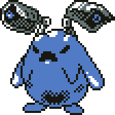
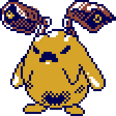
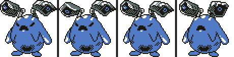

# 184 KONTROLIO

**SEX** · [← 183 HALUAL](183_HALUAL.md) · [Pokédex](../pokedex.md) · [185 AOKIGAKA →](185_AOKIGAKA.md)

<table><tr><th>Front</th><th>Shiny</th><th>Animated</th><th>Animated shiny</th></tr><tr><td align="center" valign="bottom"></td><td align="center" valign="bottom"></td><td align="center" valign="bottom"></td><td align="center" valign="bottom"></td></tr></table>

<table><tr><td valign="top"><table><tr><th colspan="3">Base stats</th></tr><tr><td>HP</td><td align="right">100</td><td>▇▇▇▇▇▇▇▇</td></tr><tr><td>Attack</td><td align="right">50</td><td>▇▇▇▇</td></tr><tr><td>Defense</td><td align="right">80</td><td>▇▇▇▇▇▇▇</td></tr><tr><td>Sp. Atk</td><td align="right">50</td><td>▇▇▇▇</td></tr><tr><td>Sp. Def</td><td align="right">80</td><td>▇▇▇▇▇▇▇</td></tr><tr><td>Speed</td><td align="right">50</td><td>▇▇▇▇</td></tr><tr><td><b>Total</b></td><td align="right"><b>410</b></td><td></td></tr></table></td><td valign="top"><table><tr><td>Catch rate</td><td>75</td></tr><tr><td>Base exp</td><td>153</td></tr><tr><td>Gender</td><td>50% female</td></tr><tr><td>Growth</td><td>Fast</td></tr></table>  party icon  palette: normal · shiny</td></tr></table>

**Animation frames** (base + 3)

## Pokédex

**AQUARABBIT** · 2'07" · 63.0 lb

> The bubble-like pattern on its stomach helps it camouflage itself when it's in the water.

## Evolution

Evolves from [HALUAL](183_HALUAL.md) (level 18)
