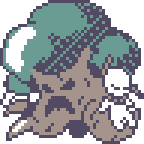

# 185 AOKIGAKA

**MINERAL** · [← 184 KONTROLIO](184_KONTROLIO.md) · [Pokédex](../pokedex.md) · [186 FETUSO →](186_FETUSO.md)

<table><tr><th>Front</th><th>Shiny</th><th>Animated</th><th>Animated shiny</th><th>Back</th></tr><tr><td align="center" valign="bottom"></td><td align="center" valign="bottom"></td><td align="center" valign="bottom"></td><td align="center" valign="bottom"></td><td align="center" valign="bottom"></td></tr></table>

<table><tr><td valign="top"><table><tr><th colspan="3">Base stats</th></tr><tr><td>HP</td><td align="right">70</td><td>▇▇▇▇▇▇</td></tr><tr><td>Attack</td><td align="right">100</td><td>▇▇▇▇▇▇▇▇</td></tr><tr><td>Defense</td><td align="right">115</td><td>▇▇▇▇▇▇▇▇▇▇</td></tr><tr><td>Sp. Atk</td><td align="right">30</td><td>▇▇</td></tr><tr><td>Sp. Def</td><td align="right">65</td><td>▇▇▇▇▇</td></tr><tr><td>Speed</td><td align="right">30</td><td>▇▇</td></tr><tr><td><b>Total</b></td><td align="right"><b>410</b></td><td></td></tr></table></td><td valign="top"><table><tr><td>Catch rate</td><td>65</td></tr><tr><td>Base exp</td><td>135</td></tr><tr><td>Gender</td><td>50% female</td></tr><tr><td>Growth</td><td>Medium Fast</td></tr></table>  party icon  palette: normal · shiny</td></tr></table>

**Animation frames** (base + 3)

## Pokédex

**IMITATION** · 3'11" · 84.0 lb

> If a tree branch shakes when there is no wind, it's a SUDOWOODO, not a tree. It hides from the rain.

## Evolution

Does not evolve.
