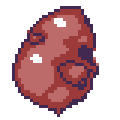
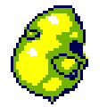
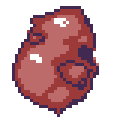
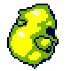

# 191 GRUMO

**DRUGS** · [← 190 MOLESTO](190_MOLESTO.md) · [Pokédex](../pokedex.md) · [192 OVARIAN →](192_OVARIAN.md)

<table><tr><th>Front</th><th>Shiny</th><th>Animated</th><th>Animated shiny</th></tr><tr><td align="center" valign="bottom"></td><td align="center" valign="bottom"></td><td align="center" valign="bottom"></td><td align="center" valign="bottom"></td></tr></table>

<table><tr><td valign="top"><table><tr><th colspan="3">Base stats</th></tr><tr><td>HP</td><td align="right">30</td><td>▇▇</td></tr><tr><td>Attack</td><td align="right">30</td><td>▇▇</td></tr><tr><td>Defense</td><td align="right">30</td><td>▇▇</td></tr><tr><td>Sp. Atk</td><td align="right">30</td><td>▇▇</td></tr><tr><td>Sp. Def</td><td align="right">30</td><td>▇▇</td></tr><tr><td>Speed</td><td align="right">30</td><td>▇▇</td></tr><tr><td><b>Total</b></td><td align="right"><b>180</b></td><td></td></tr></table></td><td valign="top"><table><tr><td>Catch rate</td><td>235</td></tr><tr><td>Base exp</td><td>52</td></tr><tr><td>Gender</td><td>50% female</td></tr><tr><td>Growth</td><td>Medium Slow</td></tr></table>  party icon  palette: normal · shiny</td></tr></table>

**Animation frames** (base + 3)

## Pokédex

**SEED** · 1'00" · 4.0 lb

> It is very weak. Its only means of defense is to shake its leaves desperately at its attacker.

## Evolution

Evolves into [OVARIAN](192_OVARIAN.md) (use SUN STONE)
