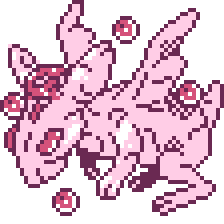

# 196 EMBRYEON

[← 195 ASPHYXIAR](195_ASPHYXIAR.md) · [Pokédex](../pokedex.md) · [197 DAMNATEON →](197_DAMNATEON.md)

  

front · shiny · battle animation

animation frames (base + 3)

 party icon

 palette: normal · shiny

| | |
|---|---|
| Type | NEURAL |
| HP | 65 `████████` |
| Attack | 65 `████████` |
| Defense | 60 `████████` |
| Sp. Atk | 130 `████████████████` |
| Sp. Def | 95 `████████████` |
| Speed | 110 `██████████████` |
| Total | 525 |
| Catch rate | 45 |
| Base exp | 197 |
| Gender | 12.5% female |
| Growth | Medium Fast |
