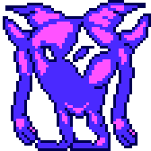

# 199 DEPRECLOWN

**SEX / NEURAL** · [← 198 SKARKROW](198_SKARKROW.md) · [Pokédex](../pokedex.md) · [200 HOSTED.GOO →](200_HOSTED_GOO.md)

<table><tr><th>Front</th><th>Shiny</th><th>Animated</th><th>Animated shiny</th></tr><tr><td align="center" valign="bottom"></td><td align="center" valign="bottom"></td><td align="center" valign="bottom"></td><td align="center" valign="bottom"></td></tr></table>

No back sprite of its own in v0.1.0.

Plays every frame evenly; the game's own script for it is incomplete in v0.1.0.

<table><tr><td valign="top"><table><tr><th colspan="3">Base stats</th></tr><tr><td>HP</td><td align="right">95</td><td>▇▇▇▇▇▇▇▇</td></tr><tr><td>Attack</td><td align="right">75</td><td>▇▇▇▇▇▇</td></tr><tr><td>Defense</td><td align="right">80</td><td>▇▇▇▇▇▇▇</td></tr><tr><td>Sp. Atk</td><td align="right">100</td><td>▇▇▇▇▇▇▇▇</td></tr><tr><td>Sp. Def</td><td align="right">110</td><td>▇▇▇▇▇▇▇▇▇</td></tr><tr><td>Speed</td><td align="right">30</td><td>▇▇</td></tr><tr><td><b>Total</b></td><td align="right"><b>490</b></td><td></td></tr></table></td><td valign="top"><table><tr><td>Catch rate</td><td>70</td></tr><tr><td>Base exp</td><td>164</td></tr><tr><td>Gender</td><td>50% female</td></tr><tr><td>Growth</td><td>Medium Fast</td></tr></table>  party icon  palette: normal · shiny</td></tr></table>

**Animation frames** (base + 2)

## Pokédex

**ROYAL** · 6'07" · 175.0 lb

> Every time it ya- wns, SHELLDER injects more poi- son into it. The poison makes it more intelligent.

Pokédex text unchanged from Pokémon Crystal.

## Evolution

Does not evolve.

## Moves

| Level | Move | Type | Power | Accuracy | PP |
|--:|---|---|--:|--:|--:|
| 1 | CURSE | ??? | — | 100% | 10 |
| 1 | TACKLE | MUTANT | 35 | 95% | 35 |
| 6 | GROWL | MUTANT | — | 100% | 40 |
| 15 | PISS BOMB | SEX | 40 | 100% | 25 |
| 20 | CONFUSION | NEURAL | 50 | 100% | 25 |
| 29 | DISABLE | MUTANT | — | 55% | 20 |
| 34 | SCAVENGE | MUTANT | 70 | 100% | 15 |
| 43 | SWAGGER | MUTANT | — | 90% | 15 |
| 48 | MK ULTRA | NEURAL | 90 | 100% | 10 |

## Wild

Not in any wild encounter table.
