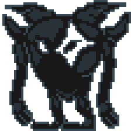

# 199 DEPRECLOWN

[← 198 SKARKROW](198_SKARKROW.md) · [Pokédex](../pokedex.md) · [200 HOSTED.GOO →](200_HOSTED_GOO.md)

 

front · shiny

 

battle animation · shiny (all frames, evenly timed: this build's script for it is incomplete)

animation frames (base + 2)

 palette: normal · shiny

| | |
|---|---|
| Type | SEX / NEURAL |
| HP | 95 `████████████` |
| Attack | 75 `█████████` |
| Defense | 80 `██████████` |
| Sp. Atk | 100 `████████████` |
| Sp. Def | 110 `██████████████` |
| Speed | 30 `████` |
| Total | 490 |
| Catch rate | 70 |
| Base exp | 164 |
| Gender | 50% female |
| Growth | Medium Fast |
