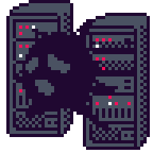
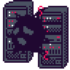

# 200 HOSTED.GOO

[← 199 DEPRECLOWN](199_DEPRECLOWN.md) · [Pokédex](../pokedex.md) · [202 CONDOMAX →](202_CONDOMAX.md)

 

front · shiny

 

battle animation · shiny

animation frames (base + 3)

 party icon

 palette: normal · shiny

| | |
|---|---|
| Type | DEATH |
| HP | 60 `████████` |
| Attack | 60 `████████` |
| Defense | 60 `████████` |
| Sp. Atk | 85 `███████████` |
| Sp. Def | 85 `███████████` |
| Speed | 85 `███████████` |
| Total | 435 |
| Catch rate | 45 |
| Base exp | 147 |
| Gender | 50% female |
| Growth | Fast |
