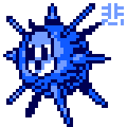
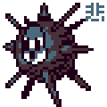

# PARATYPE DEFGHI

[← PARATYPE ABC](201_PARATYPE_A.md) · [Pokédex](../pokedex.md) · [PARATYPE JKLMNO →](201_PARATYPE_J.md)

  

front · shiny · battle animation (approximate timing: this build's animation script is incomplete)

 palette: normal · shiny

| | |
|---|---|
| Type | NEURAL |
| HP | 48 `██████` |
| Attack | 72 `█████████` |
| Defense | 48 `██████` |
| Sp. Atk | 72 `█████████` |
| Sp. Def | 48 `██████` |
| Speed | 48 `██████` |
| Total | 336 |
| Catch rate | 225 |
| Base exp | 61 |
| Gender | genderless |
| Growth | Medium Fast |

Letters DEFGHI share this sprite; stats are the Paratype species (#201).
