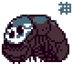

# PARATYPE PQRSTU

**NEURAL** · [← PARATYPE JKLMNO](201_PARATYPE_J.md) · [Pokédex](../pokedex.md) · [PARATYPE V →](201_PARATYPE_V.md)

<table><tr><th>Front</th><th>Shiny</th><th>Animated</th><th>Animated shiny</th></tr><tr><td align="center" valign="bottom"></td><td align="center" valign="bottom"></td><td align="center" valign="bottom"></td><td align="center" valign="bottom"></td></tr></table>

Animation: no animation: this build's frame data doesn't match the sprite.

<table><tr><td valign="top"><table><tr><th colspan="3">Base stats</th></tr><tr><td>HP</td><td align="right">48</td><td>▇▇▇▇</td></tr><tr><td>Attack</td><td align="right">72</td><td>▇▇▇▇▇▇</td></tr><tr><td>Defense</td><td align="right">48</td><td>▇▇▇▇</td></tr><tr><td>Sp. Atk</td><td align="right">72</td><td>▇▇▇▇▇▇</td></tr><tr><td>Sp. Def</td><td align="right">48</td><td>▇▇▇▇</td></tr><tr><td>Speed</td><td align="right">48</td><td>▇▇▇▇</td></tr><tr><td><b>Total</b></td><td align="right"><b>336</b></td><td></td></tr></table></td><td valign="top"><table><tr><td>Catch rate</td><td>225</td></tr><tr><td>Base exp</td><td>61</td></tr><tr><td>Gender</td><td>genderless</td></tr><tr><td>Growth</td><td>Medium Fast</td></tr></table>  palette: normal · shiny</td></tr></table>

Letters PQRSTU share this sprite; stats are the Paratype species (#201).
