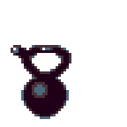

# PARATYPE V

**NEURAL** · [← PARATYPE PQRSTU](201_PARATYPE_P.md) · [Pokédex](../pokedex.md) · [PARATYPE W →](201_PARATYPE_W.md)

<table><tr><th>Front</th><th>Shiny</th><th>Animated</th><th>Animated shiny</th><th>Back</th></tr><tr><td align="center" valign="bottom"></td><td align="center" valign="bottom"></td><td align="center" valign="bottom"></td><td align="center" valign="bottom"></td><td align="center" valign="bottom"></td></tr></table>

Back sprite unchanged from Pokémon Crystal.

<table><tr><td valign="top"><table><tr><th colspan="3">Base stats</th></tr><tr><td>HP</td><td align="right">48</td><td>▇▇▇▇</td></tr><tr><td>Attack</td><td align="right">72</td><td>▇▇▇▇▇▇</td></tr><tr><td>Defense</td><td align="right">48</td><td>▇▇▇▇</td></tr><tr><td>Sp. Atk</td><td align="right">72</td><td>▇▇▇▇▇▇</td></tr><tr><td>Sp. Def</td><td align="right">48</td><td>▇▇▇▇</td></tr><tr><td>Speed</td><td align="right">48</td><td>▇▇▇▇</td></tr><tr><td><b>Total</b></td><td align="right"><b>336</b></td><td></td></tr></table></td><td valign="top"><table><tr><td>Catch rate</td><td>225</td></tr><tr><td>Base exp</td><td>61</td></tr><tr><td>Gender</td><td>genderless</td></tr><tr><td>Growth</td><td>Medium Fast</td></tr></table>  palette: normal · shiny</td></tr></table>

**Animation frames** (base + 3)

Letter V uses this sprite; stats are the Paratype species (#201).

## Pokédex

**SYMBOL** · 1'08" · 11.0 lb

> Because different types of UNOWN exist, it is said that they must have a variety of abilities.

Pokédex text unchanged from Pokémon Crystal.

## Evolution

Does not evolve.

## Moves

| Level | Move | Type | Power | Accuracy | PP |
|--:|---|---|--:|--:|--:|
| 1 | HIDDEN POWER | MUTANT | — | 100% | 15 |

## Wild

| Where | How | Chance | Levels |
|---|---|---|--:|
| Bio Impact (Ruins Of Alph Inner Chamber) | walking | 100% | 5 |
