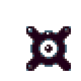
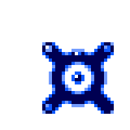
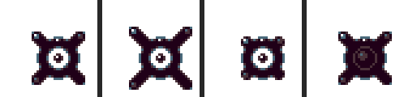

# PARATYPE X

[← PARATYPE W](201_PARATYPE_W.md) · [Pokédex](../pokedex.md) · [PARATYPE Y →](201_PARATYPE_Y.md)

 

front · shiny

 

battle animation · shiny

animation frames (base + 3)

 palette: normal · shiny

| | |
|---|---|
| Type | NEURAL |
| HP | 48 `██████` |
| Attack | 72 `█████████` |
| Defense | 48 `██████` |
| Sp. Atk | 72 `█████████` |
| Sp. Def | 48 `██████` |
| Speed | 48 `██████` |
| Total | 336 |
| Catch rate | 225 |
| Base exp | 61 |
| Gender | genderless |
| Growth | Medium Fast |

Letters X share this sprite; stats are the Paratype species (#201).
