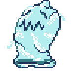
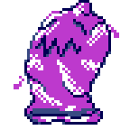
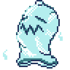
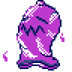
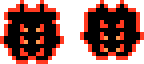

# 202 CONDOMAX

**NEURAL** · [← 200 HOSTED.GOO](200_HOSTED_GOO.md) · [Pokédex](../pokedex.md) · [203 ENIGMAGUS →](203_ENIGMAGUS.md)

<table><tr><th>Front</th><th>Shiny</th><th>Animated</th><th>Animated shiny</th></tr><tr><td align="center" valign="bottom"></td><td align="center" valign="bottom"></td><td align="center" valign="bottom"></td><td align="center" valign="bottom"></td></tr></table>

<table><tr><td valign="top"><table><tr><th colspan="3">Base stats</th></tr><tr><td>HP</td><td align="right">190</td><td>▇▇▇▇▇▇▇▇▇▇▇▇▇▇▇▇</td></tr><tr><td>Attack</td><td align="right">33</td><td>▇▇▇</td></tr><tr><td>Defense</td><td align="right">58</td><td>▇▇▇▇▇</td></tr><tr><td>Sp. Atk</td><td align="right">33</td><td>▇▇▇</td></tr><tr><td>Sp. Def</td><td align="right">58</td><td>▇▇▇▇▇</td></tr><tr><td>Speed</td><td align="right">33</td><td>▇▇▇</td></tr><tr><td><b>Total</b></td><td align="right"><b>405</b></td><td></td></tr></table></td><td valign="top"><table><tr><td>Catch rate</td><td>45</td></tr><tr><td>Base exp</td><td>177</td></tr><tr><td>Gender</td><td>50% female</td></tr><tr><td>Growth</td><td>Medium Fast</td></tr></table>  party icon  palette: normal · shiny</td></tr></table>

**Animation frames** (base + 2)

## Pokédex

**PATIENT** · 4'03" · 63.0 lb

> In order to con- ceal its black tail, it lives in a dark cave and only moves about at night.

## Evolution

Does not evolve.
