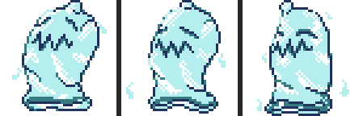

# 202 CONDOMAX

[← 200 HOSTED.GOO](200_HOSTED_GOO.md) · [Pokédex](../pokedex.md) · [203 ENIGMAGUS →](203_ENIGMAGUS.md)

  

front · shiny · battle animation

animation frames (base + 2)

 party icon

 palette: normal · shiny

| | |
|---|---|
| Type | NEURAL |
| HP | 190 `████████████████████████` |
| Attack | 33 `████` |
| Defense | 58 `███████` |
| Sp. Atk | 33 `████` |
| Sp. Def | 58 `███████` |
| Speed | 33 `████` |
| Total | 405 |
| Catch rate | 45 |
| Base exp | 177 |
| Gender | 50% female |
| Growth | Medium Fast |
