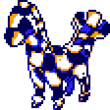

# 203 ENIGMAGUS

[← 202 CONDOMAX](202_CONDOMAX.md) · [Pokédex](../pokedex.md) · [204 HIDENLAYER →](204_HIDENLAYER.md)

  

front · shiny · battle animation (approximate timing: this build's animation script is incomplete)

animation frames (base + 3)

 party icon

 palette: normal · shiny

| | |
|---|---|
| Type | MUTANT / NEURAL |
| HP | 70 `█████████` |
| Attack | 80 `██████████` |
| Defense | 65 `████████` |
| Sp. Atk | 90 `███████████` |
| Sp. Def | 65 `████████` |
| Speed | 85 `███████████` |
| Total | 455 |
| Catch rate | 60 |
| Base exp | 149 |
| Gender | 50% female |
| Growth | Medium Fast |
