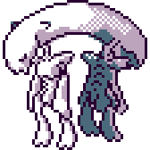

# 207 TWOMEWTWO

**NEURAL / MUTANT** · [← 206 DUOFUNTO](206_DUOFUNTO.md) · [Pokédex](../pokedex.md) · [208 HYDRAGYRUM →](208_HYDRAGYRUM.md)

<table><tr><th>Front</th><th>Shiny</th><th>Animated</th><th>Animated shiny</th></tr><tr><td align="center" valign="bottom"></td><td align="center" valign="bottom"></td><td align="center" valign="bottom"></td><td align="center" valign="bottom"></td></tr></table>

<table><tr><td valign="top"><table><tr><th colspan="3">Base stats</th></tr><tr><td>HP</td><td align="right">65</td><td>▇▇▇▇▇</td></tr><tr><td>Attack</td><td align="right">75</td><td>▇▇▇▇▇▇</td></tr><tr><td>Defense</td><td align="right">105</td><td>▇▇▇▇▇▇▇▇▇</td></tr><tr><td>Sp. Atk</td><td align="right">35</td><td>▇▇▇</td></tr><tr><td>Sp. Def</td><td align="right">65</td><td>▇▇▇▇▇</td></tr><tr><td>Speed</td><td align="right">85</td><td>▇▇▇▇▇▇▇</td></tr><tr><td><b>Total</b></td><td align="right"><b>430</b></td><td></td></tr></table></td><td valign="top"><table><tr><td>Catch rate</td><td>60</td></tr><tr><td>Base exp</td><td>108</td></tr><tr><td>Gender</td><td>50% female</td></tr><tr><td>Growth</td><td>Medium Slow</td></tr></table>  party icon  palette: normal · shiny</td></tr></table>

**Animation frames** (base + 3)

## Pokédex

**XENO TWIN** · 3'07" · 143.0 lb

> It builds its nest on a steep cliff. When it is done gliding, it hops along the ground back to its nest.

## Evolution

Does not evolve.
