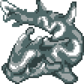

# 208 HYDRAGYRUM

**CYBER / MEDICAL** · [← 207 TWOMEWTWO](207_TWOMEWTWO.md) · [Pokédex](../pokedex.md) · [209 BLEKHOLIA →](209_BLEKHOLIA.md)

<table><tr><th>Front</th><th>Shiny</th><th>Animated</th><th>Animated shiny</th></tr><tr><td align="center" valign="bottom"></td><td align="center" valign="bottom"></td><td align="center" valign="bottom"></td><td align="center" valign="bottom"></td></tr></table>

No back sprite of its own in v0.1.0.

<table><tr><td valign="top"><table><tr><th colspan="3">Base stats</th></tr><tr><td>HP</td><td align="right">75</td><td>▇▇▇▇▇▇</td></tr><tr><td>Attack</td><td align="right">85</td><td>▇▇▇▇▇▇▇</td></tr><tr><td>Defense</td><td align="right">200</td><td>▇▇▇▇▇▇▇▇▇▇▇▇▇▇▇▇▇</td></tr><tr><td>Sp. Atk</td><td align="right">55</td><td>▇▇▇▇▇</td></tr><tr><td>Sp. Def</td><td align="right">65</td><td>▇▇▇▇▇</td></tr><tr><td>Speed</td><td align="right">30</td><td>▇▇</td></tr><tr><td><b>Total</b></td><td align="right"><b>510</b></td><td></td></tr></table></td><td valign="top"><table><tr><td>Catch rate</td><td>25</td></tr><tr><td>Base exp</td><td>196</td></tr><tr><td>Gender</td><td>50% female</td></tr><tr><td>Growth</td><td>Medium Fast</td></tr></table>  party icon  palette: normal · shiny</td></tr></table>

**Animation frames** (base + 3)

## Pokédex

**IRON SNAKE** · 30'02" · 882.0 lb

> The many small metal particles that cover this POKéMON's body reflect bright light well.

Pokédex text unchanged from Pokémon Crystal.

## Evolution

Does not evolve.

## Moves

| Level | Move | Type | Power | Accuracy | PP |
|--:|---|---|--:|--:|--:|
| 1 | TACKLE | MUTANT | 35 | 95% | 35 |
| 1 | SCREECH | MUTANT | — | 85% | 40 |
| 10 | BIND | MUTANT | 15 | 75% | 20 |
| 14 | FECAL MATTER | ORGANIC | 50 | 90% | 15 |
| 23 | HARDEN | MUTANT | — | 100% | 30 |
| 27 | RAGE | MUTANT | 20 | 100% | 20 |
| 36 | SANDSTORM | MINERAL | — | 100% | 10 |
| 40 | SLAM | MUTANT | 80 | 75% | 20 |
| 49 | CRUNCH | DOOM | 80 | 100% | 15 |

## Wild

Not in any wild encounter table.
