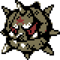
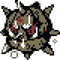

# 211 NAVALMINO

**SEX / MEDICAL** · [← 210 GALAXIAN](210_GALAXIAN.md) · [Pokédex](../pokedex.md) · [212 CYNOBI →](212_CYNOBI.md)

<table><tr><th>Front</th><th>Shiny</th><th>Animated</th><th>Animated shiny</th><th>Back</th></tr><tr><td align="center" valign="bottom"></td><td align="center" valign="bottom"></td><td align="center" valign="bottom"></td><td align="center" valign="bottom"></td><td align="center" valign="bottom"></td></tr></table>

Back sprite unchanged from Pokémon Crystal.

<table><tr><td valign="top"><table><tr><th colspan="3">Base stats</th></tr><tr><td>HP</td><td align="right">65</td><td>▇▇▇▇▇</td></tr><tr><td>Attack</td><td align="right">95</td><td>▇▇▇▇▇▇▇▇</td></tr><tr><td>Defense</td><td align="right">75</td><td>▇▇▇▇▇▇</td></tr><tr><td>Sp. Atk</td><td align="right">55</td><td>▇▇▇▇▇</td></tr><tr><td>Sp. Def</td><td align="right">55</td><td>▇▇▇▇▇</td></tr><tr><td>Speed</td><td align="right">85</td><td>▇▇▇▇▇▇▇</td></tr><tr><td><b>Total</b></td><td align="right"><b>430</b></td><td></td></tr></table></td><td valign="top"><table><tr><td>Catch rate</td><td>45</td></tr><tr><td>Base exp</td><td>100</td></tr><tr><td>Gender</td><td>50% female</td></tr><tr><td>Growth</td><td>Medium Fast</td></tr></table>  party icon  palette: normal · shiny</td></tr></table>

**Animation frames** (base + 3)

## Pokédex

**BALLOON** · 1'08" · 9.0 lb

> When faced with a larger opponent, it swallows as much water as it can to match the opponent's size.

Pokédex text unchanged from Pokémon Crystal.

## Evolution

Does not evolve.

## Moves

| Level | Move | Type | Power | Accuracy | PP |
|--:|---|---|--:|--:|--:|
| 1 | SPIKES | ORGANIC | — | 100% | 20 |
| 1 | TACKLE | MUTANT | 35 | 95% | 35 |
| 1 | DIRTY NEEDLE | MEDICAL | 15 | 100% | 35 |
| 10 | HARDEN | MUTANT | — | 100% | 30 |
| 10 | MINIMIZE | MUTANT | — | 100% | 20 |
| 19 | PISS BOMB | SEX | 40 | 100% | 25 |
| 28 | PIN MISSILE | MILITARY | 14 | 85% | 20 |
| 37 | TAKE DOWN | MUTANT | 90 | 85% | 20 |
| 46 | MEGA SQUIRT | SEX | 120 | 80% | 5 |

## Wild

Not in any wild encounter table.
