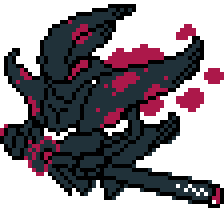

# 212 CYNOBI

[← 211 NAVALMINO](211_NAVALMINO.md) · [Pokédex](../pokedex.md) · [213 PROGLOTTO →](213_PROGLOTTO.md)

 

front · shiny

 

battle animation · shiny (all frames, evenly timed: this build's script for it is incomplete)

animation frames (base + 3)

 palette: normal · shiny

| | |
|---|---|
| Type | MILITARY / CYBER |
| HP | 70 `█████████` |
| Attack | 130 `████████████████` |
| Defense | 100 `████████████` |
| Sp. Atk | 55 `███████` |
| Sp. Def | 80 `██████████` |
| Speed | 65 `████████` |
| Total | 500 |
| Catch rate | 25 |
| Base exp | 200 |
| Gender | 50% female |
| Growth | Medium Fast |
