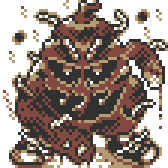

# 213 PROGLOTTO

**MILITARY / MINERAL** · [← 212 CYNOBI](212_CYNOBI.md) · [Pokédex](../pokedex.md) · [214 KINBUGUBI →](214_KINBUGUBI.md)

<table><tr><th>Front</th><th>Shiny</th><th>Animated</th><th>Animated shiny</th></tr><tr><td align="center" valign="bottom"></td><td align="center" valign="bottom"></td><td align="center" valign="bottom"></td><td align="center" valign="bottom"></td></tr></table>

<table><tr><td valign="top"><table><tr><th colspan="3">Base stats</th></tr><tr><td>HP</td><td align="right">20</td><td>▇▇</td></tr><tr><td>Attack</td><td align="right">10</td><td>▇</td></tr><tr><td>Defense</td><td align="right">230</td><td>▇▇▇▇▇▇▇▇▇▇▇▇▇▇▇▇▇▇▇</td></tr><tr><td>Sp. Atk</td><td align="right">10</td><td>▇</td></tr><tr><td>Sp. Def</td><td align="right">230</td><td>▇▇▇▇▇▇▇▇▇▇▇▇▇▇▇▇▇▇▇</td></tr><tr><td>Speed</td><td align="right">5</td><td>▇</td></tr><tr><td><b>Total</b></td><td align="right"><b>505</b></td><td></td></tr></table></td><td valign="top"><table><tr><td>Catch rate</td><td>190</td></tr><tr><td>Base exp</td><td>80</td></tr><tr><td>Gender</td><td>50% female</td></tr><tr><td>Growth</td><td>Medium Slow</td></tr></table>  party icon  palette: normal · shiny</td></tr></table>

## Pokédex

**MOLD** · 2'00" · 45.0 lb

> The fluid secreted by its toes carves holes in rocks for nesting and can be mixed with BERRIES to make a drink.

## Evolution

Evolves from [SHITTO](132_SHITTO.md) (use X-RAY)
