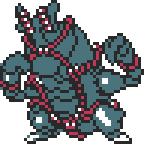
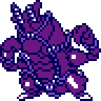
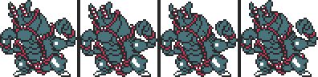

# 214 KINBUGUBI

**MILITARY / VIOLENCE** · [← 213 PROGLOTTO](213_PROGLOTTO.md) · [Pokédex](../pokedex.md) · [215 KUNOIGA →](215_KUNOIGA.md)

<table><tr><th>Front</th><th>Shiny</th><th>Animated</th><th>Animated shiny</th><th>Back</th></tr><tr><td align="center" valign="bottom"></td><td align="center" valign="bottom"></td><td align="center" valign="bottom"></td><td align="center" valign="bottom"></td><td align="center" valign="bottom"></td></tr></table>

Back sprite unchanged from Pokémon Crystal.

<table><tr><td valign="top"><table><tr><th colspan="3">Base stats</th></tr><tr><td>HP</td><td align="right">80</td><td>▇▇▇▇▇▇▇</td></tr><tr><td>Attack</td><td align="right">125</td><td>▇▇▇▇▇▇▇▇▇▇</td></tr><tr><td>Defense</td><td align="right">75</td><td>▇▇▇▇▇▇</td></tr><tr><td>Sp. Atk</td><td align="right">40</td><td>▇▇▇</td></tr><tr><td>Sp. Def</td><td align="right">95</td><td>▇▇▇▇▇▇▇▇</td></tr><tr><td>Speed</td><td align="right">85</td><td>▇▇▇▇▇▇▇</td></tr><tr><td><b>Total</b></td><td align="right"><b>500</b></td><td></td></tr></table></td><td valign="top"><table><tr><td>Catch rate</td><td>45</td></tr><tr><td>Base exp</td><td>200</td></tr><tr><td>Gender</td><td>50% female</td></tr><tr><td>Growth</td><td>Slow</td></tr></table>  party icon  palette: normal · shiny</td></tr></table>

**Animation frames** (base + 3)

## Pokédex

**SINGLEHORN** · 4'11" · 119.0 lb

> With its Herculean powers, it can easily throw arou- nd an object that is 100 times its own weight.

Pokédex text unchanged from Pokémon Crystal.

## Evolution

Does not evolve.

## Moves

| Level | Move | Type | Power | Accuracy | PP |
|--:|---|---|--:|--:|--:|
| 1 | TACKLE | MUTANT | 35 | 95% | 35 |
| 1 | LEER | MUTANT | — | 100% | 30 |
| 6 | PENTOTHAL | DRUGS | 65 | 100% | 25 |
| 12 | ENDURE | MUTANT | — | 100% | 10 |
| 19 | FURY ATTACK | MUTANT | 15 | 85% | 20 |
| 27 | COUNTER | VIOLENCE | — | 100% | 20 |
| 35 | TAKE DOWN | MUTANT | 90 | 85% | 20 |
| 44 | REVERSAL | VIOLENCE | — | 100% | 15 |
| 54 | MEGAHORN | MILITARY | 120 | 85% | 10 |

## Wild

Not in any wild encounter table.
