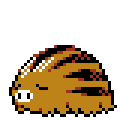

# 220 SWINUB

**CHEMICAL / ORGANIC** · [← 219 MAGCARGO](219_MAGCARGO.md) · [Pokédex](../pokedex.md) · [221 PILOSWINE →](221_PILOSWINE.md)

<table><tr><th>Front</th><th>Shiny</th><th>Animated</th><th>Animated shiny</th><th>Back</th></tr><tr><td align="center" valign="bottom"></td><td align="center" valign="bottom"></td><td align="center" valign="bottom"></td><td align="center" valign="bottom"></td><td align="center" valign="bottom"></td></tr></table>

<table><tr><td valign="top"><table><tr><th colspan="3">Base stats</th></tr><tr><td>HP</td><td align="right">50</td><td>▇▇▇▇</td></tr><tr><td>Attack</td><td align="right">50</td><td>▇▇▇▇</td></tr><tr><td>Defense</td><td align="right">40</td><td>▇▇▇</td></tr><tr><td>Sp. Atk</td><td align="right">30</td><td>▇▇</td></tr><tr><td>Sp. Def</td><td align="right">30</td><td>▇▇</td></tr><tr><td>Speed</td><td align="right">50</td><td>▇▇▇▇</td></tr><tr><td><b>Total</b></td><td align="right"><b>250</b></td><td></td></tr></table></td><td valign="top"><table><tr><td>Catch rate</td><td>225</td></tr><tr><td>Base exp</td><td>78</td></tr><tr><td>Gender</td><td>50% female</td></tr><tr><td>Growth</td><td>Slow</td></tr></table>  party icon  palette: normal · shiny</td></tr></table>

**Animation frames** (base + 3)

## Pokédex

**PIG** · 1'04" · 14.0 lb

> It uses the tip of its nose to dig for food. Its nose is so tough that even frozen ground poses no problem.

## Evolution

Evolves into [PILOSWINE](221_PILOSWINE.md) (level 33)
