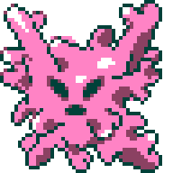
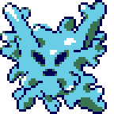
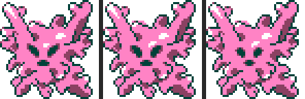

# 222 NEURAPSYS

[← 221 PILOSWINE](221_PILOSWINE.md) · [Pokédex](../pokedex.md) · [223 ANIFISH →](223_ANIFISH.md)

 

front · shiny

 

battle animation · shiny (all frames, evenly timed: this build's script for it is incomplete)

animation frames (base + 2)

 party icon

 palette: normal · shiny

| | |
|---|---|
| Type | SEX / MINERAL |
| HP | 55 `███████` |
| Attack | 55 `███████` |
| Defense | 85 `███████████` |
| Sp. Atk | 65 `████████` |
| Sp. Def | 85 `███████████` |
| Speed | 35 `████` |
| Total | 380 |
| Catch rate | 60 |
| Base exp | 113 |
| Gender | 75% female |
| Growth | Fast |
