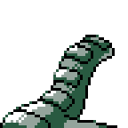

# 232 DONPHAN

**ORGANIC** · [← 231 PHANPY](231_PHANPY.md) · [Pokédex](../pokedex.md) · [233 BIBRODO →](233_BIBRODO.md)

<table><tr><th>Front</th><th>Shiny</th><th>Animated</th><th>Animated shiny</th><th>Back</th></tr><tr><td align="center" valign="bottom"></td><td align="center" valign="bottom"></td><td align="center" valign="bottom"></td><td align="center" valign="bottom"></td><td align="center" valign="bottom"></td></tr></table>

Back sprite unchanged from Pokémon Crystal.

<table><tr><td valign="top"><table><tr><th colspan="3">Base stats</th></tr><tr><td>HP</td><td align="right">90</td><td>▇▇▇▇▇▇▇▇</td></tr><tr><td>Attack</td><td align="right">120</td><td>▇▇▇▇▇▇▇▇▇▇</td></tr><tr><td>Defense</td><td align="right">120</td><td>▇▇▇▇▇▇▇▇▇▇</td></tr><tr><td>Sp. Atk</td><td align="right">60</td><td>▇▇▇▇▇</td></tr><tr><td>Sp. Def</td><td align="right">60</td><td>▇▇▇▇▇</td></tr><tr><td>Speed</td><td align="right">50</td><td>▇▇▇▇</td></tr><tr><td><b>Total</b></td><td align="right"><b>500</b></td><td></td></tr></table></td><td valign="top"><table><tr><td>Catch rate</td><td>60</td></tr><tr><td>Base exp</td><td>189</td></tr><tr><td>Gender</td><td>50% female</td></tr><tr><td>Growth</td><td>Medium Fast</td></tr></table>  party icon  palette: normal · shiny</td></tr></table>

**Animation frames** (base + 5)

## Pokédex

**ARMOR** · 3'07" · 265.0 lb

> Because this POKéMON's skin is so tough, a normal attack won't even leave a scratch on it.

Pokédex text unchanged from Pokémon Crystal.

## Evolution

Evolves from [PHANPY](231_PHANPY.md) (level 25)

## Moves

| Level | Move | Type | Power | Accuracy | PP |
|--:|---|---|--:|--:|--:|
| 1 | PENTOTHAL | DRUGS | 65 | 100% | 25 |
| 1 | GROWL | MUTANT | — | 100% | 40 |
| 9 | DEFENSE CURL | MUTANT | — | 100% | 40 |
| 17 | FLAIL | MUTANT | — | 100% | 15 |
| 25 | FURY ATTACK | MUTANT | 15 | 85% | 20 |
| 33 | ROLLOUT | MINERAL | 30 | 90% | 20 |
| 41 | RAPID SPIN | MUTANT | 20 | 100% | 40 |
| 49 | EARTHQUAKE | ORGANIC | 100 | 100% | 10 |

## Wild

Not in any wild encounter table.
