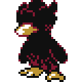
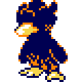
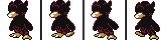

# 240 CARBIFY

**SATANIC** · [← 239 PHOTOKID](239_PHOTOKID.md) · [Pokédex](../pokedex.md) · [241 INTENSIVO →](241_INTENSIVO.md)

<table><tr><th>Front</th><th>Shiny</th><th>Animated</th><th>Animated shiny</th></tr><tr><td align="center" valign="bottom"></td><td align="center" valign="bottom"></td><td align="center" valign="bottom"></td><td align="center" valign="bottom"></td></tr></table>

No back sprite of its own in v0.1.0.

Plays every frame evenly; the game's own script for it is incomplete in v0.1.0.

<table><tr><td valign="top"><table><tr><th colspan="3">Base stats</th></tr><tr><td>HP</td><td align="right">45</td><td>▇▇▇▇</td></tr><tr><td>Attack</td><td align="right">75</td><td>▇▇▇▇▇▇</td></tr><tr><td>Defense</td><td align="right">37</td><td>▇▇▇</td></tr><tr><td>Sp. Atk</td><td align="right">70</td><td>▇▇▇▇▇▇</td></tr><tr><td>Sp. Def</td><td align="right">55</td><td>▇▇▇▇▇</td></tr><tr><td>Speed</td><td align="right">83</td><td>▇▇▇▇▇▇▇</td></tr><tr><td><b>Total</b></td><td align="right"><b>365</b></td><td></td></tr></table></td><td valign="top"><table><tr><td>Catch rate</td><td>45</td></tr><tr><td>Base exp</td><td>117</td></tr><tr><td>Gender</td><td>25% female</td></tr><tr><td>Growth</td><td>Medium Fast</td></tr></table>  party icon  palette: normal · shiny</td></tr></table>

**Animation frames** (base + 3)

## Pokédex

**LIVE COAL** · 2'04" · 47.0 lb

> It naturally spits an 1100-degree flame. It is said when many appear, it heralds a volcanic eruption.

Pokédex text unchanged from Pokémon Crystal.

## Evolution

Evolves into [BURNAR](126_BURNAR.md) (level 30)

## Moves

| Level | Move | Type | Power | Accuracy | PP |
|--:|---|---|--:|--:|--:|
| 1 | EMBER | SATANIC | 40 | 100% | 25 |
| 7 | LEER | MUTANT | — | 100% | 30 |
| 13 | SMOG | MEDICAL | 20 | 70% | 20 |
| 19 | FIRE PUNCH | SATANIC | 75 | 100% | 15 |
| 25 | SMOKEGRENADE | MUTANT | — | 100% | 20 |
| 31 | SUNNY DAY | SATANIC | — | 90% | 5 |
| 37 | FLAMETHROWER | SATANIC | 95 | 100% | 15 |
| 43 | CONFUSE RAY | DEATH | — | 100% | 10 |
| 49 | FIRE BLAST | SATANIC | 120 | 85% | 5 |

## Wild

Not in any wild encounter table.
