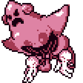
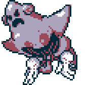
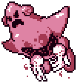
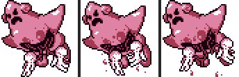

# 242 POSTPARTOU

**MUTANT** · [← 241 INTENSIVO](241_INTENSIVO.md) · [Pokédex](../pokedex.md) · [243 ROTARAX →](243_ROTARAX.md)

<table><tr><th>Front</th><th>Shiny</th><th>Animated</th><th>Animated shiny</th></tr><tr><td align="center" valign="bottom"></td><td align="center" valign="bottom"></td><td align="center" valign="bottom"></td><td align="center" valign="bottom"></td></tr></table>

<table><tr><td valign="top"><table><tr><th colspan="3">Base stats</th></tr><tr><td>HP</td><td align="right">255</td><td>▇▇▇▇▇▇▇▇▇▇▇▇▇▇▇▇▇▇▇▇▇</td></tr><tr><td>Attack</td><td align="right">10</td><td>▇</td></tr><tr><td>Defense</td><td align="right">10</td><td>▇</td></tr><tr><td>Sp. Atk</td><td align="right">75</td><td>▇▇▇▇▇▇</td></tr><tr><td>Sp. Def</td><td align="right">135</td><td>▇▇▇▇▇▇▇▇▇▇▇</td></tr><tr><td>Speed</td><td align="right">55</td><td>▇▇▇▇▇</td></tr><tr><td><b>Total</b></td><td align="right"><b>540</b></td><td></td></tr></table></td><td valign="top"><table><tr><td>Catch rate</td><td>30</td></tr><tr><td>Base exp</td><td>255</td></tr><tr><td>Gender</td><td>100% female</td></tr><tr><td>Growth</td><td>Fast</td></tr></table>  party icon  palette: normal · shiny</td></tr></table>

**Animation frames** (base + 2)

## Pokédex

**DEPRESSION** · 4'11" · 103.0 lb

> Having a child can bring serious mood disorders. That dead newborn in your hands will look like a dream.

## Evolution

Evolves from [PREGNANTA](113_PREGNANTA.md) (happiness, any time)
