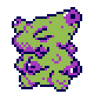
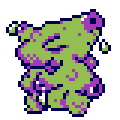
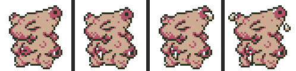

# 246 SEBUTAR

**MINERAL / ORGANIC** · [← 245 SKYLITE](245_SKYLITE.md) · [Pokédex](../pokedex.md) · [247 MYCOTAR →](247_MYCOTAR.md)

<table><tr><th>Front</th><th>Shiny</th><th>Animated</th><th>Animated shiny</th></tr><tr><td align="center" valign="bottom"></td><td align="center" valign="bottom"></td><td align="center" valign="bottom"></td><td align="center" valign="bottom"></td></tr></table>

<table><tr><td valign="top"><table><tr><th colspan="3">Base stats</th></tr><tr><td>HP</td><td align="right">50</td><td>▇▇▇▇</td></tr><tr><td>Attack</td><td align="right">64</td><td>▇▇▇▇▇</td></tr><tr><td>Defense</td><td align="right">50</td><td>▇▇▇▇</td></tr><tr><td>Sp. Atk</td><td align="right">45</td><td>▇▇▇▇</td></tr><tr><td>Sp. Def</td><td align="right">50</td><td>▇▇▇▇</td></tr><tr><td>Speed</td><td align="right">41</td><td>▇▇▇</td></tr><tr><td><b>Total</b></td><td align="right"><b>300</b></td><td></td></tr></table></td><td valign="top"><table><tr><td>Catch rate</td><td>45</td></tr><tr><td>Base exp</td><td>67</td></tr><tr><td>Gender</td><td>50% female</td></tr><tr><td>Growth</td><td>Slow</td></tr></table>  party icon  palette: normal · shiny</td></tr></table>

**Animation frames** (base + 3)

## Pokédex

**ROCK SKIN** · 2'00" · 159.0 lb

> Born deep under- ground, this POKéMON becomes a pupa after eating enough dirt to make a mountain.

## Evolution

Evolves into [MYCOTAR](247_MYCOTAR.md) (level 30)
