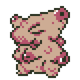
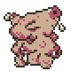

# 246 SEBUTAR

[← 245 SKYLITE](245_SKYLITE.md) · [Pokédex](../pokedex.md) · [247 MYCOTAR →](247_MYCOTAR.md)

  

front · shiny · battle animation

animation frames (base + 3)

 party icon

 palette: normal · shiny

| | |
|---|---|
| Type | MINERAL / ORGANIC |
| HP | 50 `██████` |
| Attack | 64 `████████` |
| Defense | 50 `██████` |
| Sp. Atk | 45 `██████` |
| Sp. Def | 50 `██████` |
| Speed | 41 `█████` |
| Total | 300 |
| Catch rate | 45 |
| Base exp | 67 |
| Gender | 50% female |
| Growth | Slow |
