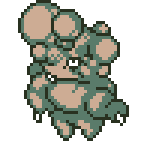
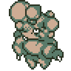
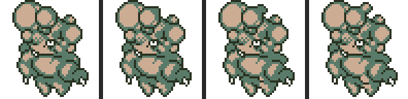

# 247 MYCOTAR

**MINERAL / ORGANIC** · [← 246 SEBUTAR](246_SEBUTAR.md) · [Pokédex](../pokedex.md) · [248 MELANOTAR →](248_MELANOTAR.md)

<table><tr><th>Front</th><th>Shiny</th><th>Animated</th><th>Animated shiny</th><th>Back</th></tr><tr><td align="center" valign="bottom"></td><td align="center" valign="bottom"></td><td align="center" valign="bottom"></td><td align="center" valign="bottom"></td><td align="center" valign="bottom"></td></tr></table>

Back sprite unchanged from Pokémon Crystal.

<table><tr><td valign="top"><table><tr><th colspan="3">Base stats</th></tr><tr><td>HP</td><td align="right">70</td><td>▇▇▇▇▇▇</td></tr><tr><td>Attack</td><td align="right">84</td><td>▇▇▇▇▇▇▇</td></tr><tr><td>Defense</td><td align="right">70</td><td>▇▇▇▇▇▇</td></tr><tr><td>Sp. Atk</td><td align="right">65</td><td>▇▇▇▇▇</td></tr><tr><td>Sp. Def</td><td align="right">70</td><td>▇▇▇▇▇▇</td></tr><tr><td>Speed</td><td align="right">51</td><td>▇▇▇▇</td></tr><tr><td><b>Total</b></td><td align="right"><b>410</b></td><td></td></tr></table></td><td valign="top"><table><tr><td>Catch rate</td><td>45</td></tr><tr><td>Base exp</td><td>144</td></tr><tr><td>Gender</td><td>50% female</td></tr><tr><td>Growth</td><td>Slow</td></tr></table>  party icon  palette: normal · shiny</td></tr></table>

**Animation frames** (base + 3)

## Pokédex

**HARD SHELL** · 3'11" · 335.0 lb

> It will not stay still, even while it's a pupa. It already has arms and legs under its solid shell.

Pokédex text unchanged from Pokémon Crystal.

## Evolution

Evolves from [SEBUTAR](246_SEBUTAR.md) (level 30) Evolves into [MELANOTAR](248_MELANOTAR.md) (level 55)

## Moves

| Level | Move | Type | Power | Accuracy | PP |
|--:|---|---|--:|--:|--:|
| 1 | BITE | DOOM | 60 | 100% | 25 |
| 1 | LEER | MUTANT | — | 100% | 30 |
| 1 | SANDSTORM | MINERAL | — | 100% | 10 |
| 1 | SCREECH | MUTANT | — | 85% | 40 |
| 8 | SANDSTORM | MINERAL | — | 100% | 10 |
| 15 | SCREECH | MUTANT | — | 85% | 40 |
| 22 | ROCK SLIDE | MINERAL | 75 | 90% | 10 |
| 29 | THRASH | MUTANT | 90 | 100% | 20 |
| 38 | SCARY FACE | MUTANT | — | 90% | 10 |
| 47 | CRUNCH | DOOM | 80 | 100% | 15 |
| 56 | EARTHQUAKE | ORGANIC | 100 | 100% | 10 |
| 65 | ETERNAL TAO | DIVINITY | 150 | 100% | 5 |

## Wild

| Where | How | Chance | Levels |
|---|---|---|--:|
| Silver Cave Room 3 | walking | 1% morning/day | 20 |
