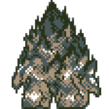
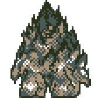
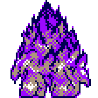
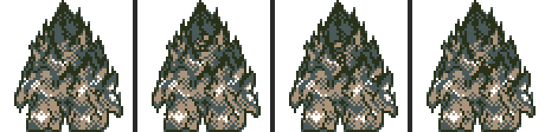

# 248 MELANOTAR

[← 247 MYCOTAR](247_MYCOTAR.md) · [Pokédex](../pokedex.md) · [249 DEMEMENTIA →](249_DEMEMENTIA.md)

 

front · shiny

 

battle animation · shiny (all frames, evenly timed: this build's script for it is incomplete)

animation frames (base + 3)

 party icon

 palette: normal · shiny

| | |
|---|---|
| Type | MINERAL / DOOM |
| HP | 100 `████████████` |
| Attack | 134 `█████████████████` |
| Defense | 110 `██████████████` |
| Sp. Atk | 95 `████████████` |
| Sp. Def | 100 `████████████` |
| Speed | 61 `████████` |
| Total | 600 |
| Catch rate | 45 |
| Base exp | 218 |
| Gender | 50% female |
| Growth | Slow |
