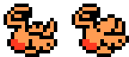

# 249 DEMEMENTIA

[← 248 MELANOTAR](248_MELANOTAR.md) · [Pokédex](../pokedex.md) · [250 PAGOLDIA →](250_PAGOLDIA.md)

 

front · shiny

 

battle animation · shiny (all frames, evenly timed: this build's script for it is incomplete)

animation frames (base + 3)

 party icon

 palette: normal · shiny

| | |
|---|---|
| Type | NEURAL / DIVINITY |
| HP | 106 `█████████████` |
| Attack | 90 `███████████` |
| Defense | 130 `████████████████` |
| Sp. Atk | 90 `███████████` |
| Sp. Def | 154 `███████████████████` |
| Speed | 110 `██████████████` |
| Total | 680 |
| Catch rate | 3 |
| Base exp | 220 |
| Gender | genderless |
| Growth | Slow |
