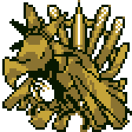
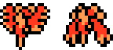

# 250 PAGOLDIA

**SATANIC / MECHANIC** · [← 249 DEMEMENTIA](249_DEMEMENTIA.md) · [Pokédex](../pokedex.md) · [251 CEREBRI →](251_CEREBRI.md)

<table><tr><th>Front</th><th>Shiny</th><th>Animated</th><th>Animated shiny</th></tr><tr><td align="center" valign="bottom"></td><td align="center" valign="bottom"></td><td align="center" valign="bottom"></td><td align="center" valign="bottom"></td></tr></table>

Plays every frame evenly; the game's own script for it is incomplete in v0.1.0.

<table><tr><td valign="top"><table><tr><th colspan="3">Base stats</th></tr><tr><td>HP</td><td align="right">106</td><td>▇▇▇▇▇▇▇▇▇</td></tr><tr><td>Attack</td><td align="right">130</td><td>▇▇▇▇▇▇▇▇▇▇▇</td></tr><tr><td>Defense</td><td align="right">90</td><td>▇▇▇▇▇▇▇▇</td></tr><tr><td>Sp. Atk</td><td align="right">110</td><td>▇▇▇▇▇▇▇▇▇</td></tr><tr><td>Sp. Def</td><td align="right">154</td><td>▇▇▇▇▇▇▇▇▇▇▇▇▇</td></tr><tr><td>Speed</td><td align="right">90</td><td>▇▇▇▇▇▇▇▇</td></tr><tr><td><b>Total</b></td><td align="right"><b>680</b></td><td></td></tr></table></td><td valign="top"><table><tr><td>Catch rate</td><td>3</td></tr><tr><td>Base exp</td><td>220</td></tr><tr><td>Gender</td><td>genderless</td></tr><tr><td>Growth</td><td>Slow</td></tr></table>  party icon  palette: normal · shiny</td></tr></table>

**Animation frames** (base + 3)

