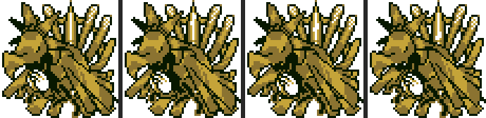

# 250 PAGOLDIA

**SATANIC / MECHANIC** · [← 249 DEMEMENTIA](249_DEMEMENTIA.md) · [Pokédex](../pokedex.md) · [251 CEREBRI →](251_CEREBRI.md)

<table><tr><th>Front</th><th>Shiny</th><th>Animated</th><th>Animated shiny</th><th>Back</th></tr><tr><td align="center" valign="bottom"></td><td align="center" valign="bottom"></td><td align="center" valign="bottom"></td><td align="center" valign="bottom"></td><td align="center" valign="bottom"></td></tr></table>

Back sprite unchanged from Pokémon Crystal.

Plays every frame evenly; the game's own script for it is incomplete in v0.1.0.

<table><tr><td valign="top"><table><tr><th colspan="3">Base stats</th></tr><tr><td>HP</td><td align="right">106</td><td>▇▇▇▇▇▇▇▇▇</td></tr><tr><td>Attack</td><td align="right">130</td><td>▇▇▇▇▇▇▇▇▇▇▇</td></tr><tr><td>Defense</td><td align="right">90</td><td>▇▇▇▇▇▇▇▇</td></tr><tr><td>Sp. Atk</td><td align="right">110</td><td>▇▇▇▇▇▇▇▇▇</td></tr><tr><td>Sp. Def</td><td align="right">154</td><td>▇▇▇▇▇▇▇▇▇▇▇▇▇</td></tr><tr><td>Speed</td><td align="right">90</td><td>▇▇▇▇▇▇▇▇</td></tr><tr><td><b>Total</b></td><td align="right"><b>680</b></td><td></td></tr></table></td><td valign="top"><table><tr><td>Catch rate</td><td>3</td></tr><tr><td>Base exp</td><td>220</td></tr><tr><td>Gender</td><td>genderless</td></tr><tr><td>Growth</td><td>Slow</td></tr></table>  party icon  palette: normal · shiny</td></tr></table>

**Animation frames** (base + 3)

## Pokédex

**RAINBOW** · 12'06" · 439.0 lb

> It will reveal itself before a pure-hearted trainer by shining its bright rain- bow-colored wings.

Pokédex text unchanged from Pokémon Crystal.

## Evolution

Does not evolve.

## Moves

| Level | Move | Type | Power | Accuracy | PP |
|--:|---|---|--:|--:|--:|
| 1 | SACRED FIRE | SATANIC | 100 | 95% | 5 |
| 11 | SAFEGUARD | MUTANT | — | 100% | 25 |
| 22 | GUST | MECHANIC | 40 | 100% | 35 |
| 33 | RECOVER | MUTANT | — | 100% | 20 |
| 44 | FIRE BLAST | SATANIC | 120 | 85% | 5 |
| 55 | SUNNY DAY | SATANIC | — | 90% | 5 |
| 66 | SWIFT | MUTANT | 60 | 100% | 20 |
| 77 | WHIRLWIND | MUTANT | — | 100% | 20 |
| 88 | ANCIENTPOWER | MINERAL | 60 | 100% | 5 |
| 99 | FUTURE SIGHT | NEURAL | 80 | 90% | 15 |

## Wild

Not in any wild encounter table.
