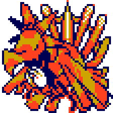
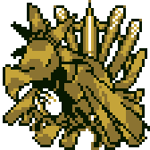

# 250 PAGOLDIA

[← 249 DEMEMENTIA](249_DEMEMENTIA.md) · [Pokédex](../pokedex.md) · [251 CEREBRI →](251_CEREBRI.md)

  

front · shiny · battle animation (approximate timing: this build's animation script is incomplete)

animation frames (base + 3)

 palette: normal · shiny

| | |
|---|---|
| Type | SATANIC / MECHANIC |
| HP | 106 `█████████████` |
| Attack | 130 `████████████████` |
| Defense | 90 `███████████` |
| Sp. Atk | 110 `██████████████` |
| Sp. Def | 154 `███████████████████` |
| Speed | 90 `███████████` |
| Total | 680 |
| Catch rate | 3 |
| Base exp | 220 |
| Gender | genderless |
| Growth | Slow |
