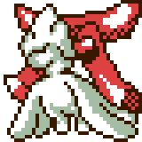
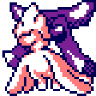

# 251 CEREBRI

[← 250 PAGOLDIA](250_PAGOLDIA.md) · [Pokédex](../pokedex.md) · [PARATYPE ABC →](201_PARATYPE_A.md)

 

front · shiny

 

battle animation · shiny (all frames, evenly timed: this build's script for it is incomplete)

animation frames (base + 3)

 party icon

 palette: normal · shiny

| | |
|---|---|
| Type | NEURAL / DRUGS |
| HP | 100 `████████████` |
| Attack | 100 `████████████` |
| Defense | 100 `████████████` |
| Sp. Atk | 100 `████████████` |
| Sp. Def | 100 `████████████` |
| Speed | 100 `████████████` |
| Total | 600 |
| Catch rate | 45 |
| Base exp | 64 |
| Gender | genderless |
| Growth | Medium Slow |
