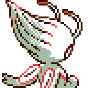
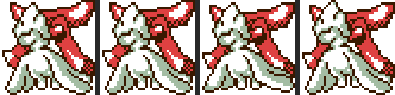

# 251 CEREBRI

**NEURAL / DRUGS** · [← 250 PAGOLDIA](250_PAGOLDIA.md) · [Pokédex](../pokedex.md) · [PARATYPE ABC →](201_PARATYPE_A.md)

<table><tr><th>Front</th><th>Shiny</th><th>Animated</th><th>Animated shiny</th><th>Back</th></tr><tr><td align="center" valign="bottom"></td><td align="center" valign="bottom"></td><td align="center" valign="bottom"></td><td align="center" valign="bottom"></td><td align="center" valign="bottom"></td></tr></table>

Back sprite unchanged from Pokémon Crystal.

Plays every frame evenly; the game's own script for it is incomplete in v0.1.0.

<table><tr><td valign="top"><table><tr><th colspan="3">Base stats</th></tr><tr><td>HP</td><td align="right">100</td><td>▇▇▇▇▇▇▇▇</td></tr><tr><td>Attack</td><td align="right">100</td><td>▇▇▇▇▇▇▇▇</td></tr><tr><td>Defense</td><td align="right">100</td><td>▇▇▇▇▇▇▇▇</td></tr><tr><td>Sp. Atk</td><td align="right">100</td><td>▇▇▇▇▇▇▇▇</td></tr><tr><td>Sp. Def</td><td align="right">100</td><td>▇▇▇▇▇▇▇▇</td></tr><tr><td>Speed</td><td align="right">100</td><td>▇▇▇▇▇▇▇▇</td></tr><tr><td><b>Total</b></td><td align="right"><b>600</b></td><td></td></tr></table></td><td valign="top"><table><tr><td>Catch rate</td><td>45</td></tr><tr><td>Base exp</td><td>64</td></tr><tr><td>Gender</td><td>genderless</td></tr><tr><td>Growth</td><td>Medium Slow</td></tr></table>  party icon  palette: normal · shiny</td></tr></table>

**Animation frames** (base + 3)

## Pokédex

**PINEALGLAND** · 2'00" · 11.0 lb

> Revered as a guardian of the forest, CELEBI appears wherever beautiful forests exist.

## Evolution

Does not evolve.

## Moves

| Level | Move | Type | Power | Accuracy | PP |
|--:|---|---|--:|--:|--:|
| 1 | LEECH SEED | DRUGS | — | 90% | 10 |
| 1 | CONFUSION | NEURAL | 50 | 100% | 25 |
| 1 | RECOVER | MUTANT | — | 100% | 20 |
| 1 | HEAL BELL | MUTANT | — | 100% | 5 |
| 10 | SAFEGUARD | MUTANT | — | 100% | 25 |
| 20 | ANCIENTPOWER | MINERAL | 60 | 100% | 5 |
| 30 | FUTURE SIGHT | NEURAL | 80 | 90% | 15 |
| 40 | BATON PASS | MUTANT | — | 100% | 40 |
| 50 | PERISH SONG | MUTANT | — | 100% | 5 |

## Wild

Not in any wild encounter table.
