# Trainers

542 trainers in 67 classes · [all sheets](../README.md)

See the [trainer data](../data/trainers.json) for held items and movesets.

[ERIC&amp;DYLAN](#01-eric-dylan) · [INMATE (AILEEN)](#02-inmate) · [INMATE (JEFFREY)](#03-inmate) · [CULT LEADER](#04-cult-leader) · [U.N.A.](#05-u-n-a) · [JIHADIST](#06-jihadist) · [POGO CLOWN](#07-pogo-clown) · [POPE](#08-pope) · [NOIA AGENT](#09-noia-agent) · [POKéMON PROF.](#10-pokemon-prof) · [DIGITAL世界](#11-digital) · [PKMN TRAINER](#12-pkmn-trainer) · [ELITE FOUR (BRUNO)](#13-elite-four) · [ELITE FOUR (KAREN)](#14-elite-four) · [ELITE FOUR (KOGA)](#15-elite-four) · [PURE MATH](#16-pure-math) · [LEADER (BROCK)](#17-leader) · [LEADER (MISTY)](#18-leader) · [LEADER (LT.SURGE)](#19-leader) · [SCIENTIST](#20-scientist) · [LEADER (ERIKA)](#21-leader) · [MENINO D RUA](#22-menino-d-rua) · [GOONER](#23-gooner) · [MASS SHOOTER](#24-mass-shooter) · [FEMBOY](#25-femboy) · [LEADER (JANINE)](#26-leader) · [COOLTRAINER (NICK, AARON, …)](#27-cooltrainer) · [COOLTRAINER (GWEN, LOIS, …)](#28-cooltrainer) · [E-GIRL](#29-e-girl) · [FENTANYL](#30-fentanyl) · [PLAGUEcorp.](#31-plaguecorp) · [REPTILIAN](#32-reptilian) · [SKIER](#33-skier) · [TEACHER](#34-teacher) · [LEADER (SABRINA)](#35-leader) · [MARANZA](#36-maranza) · [FISHER](#37-fisher) · [HUMAN](#38-human) · [SWIMMER♀](#39-swimmer) · [PRISONER](#40-prisoner) · [OBSCURE](#41-obscure) · [RIVAL](#42-rival) · [GUITARIST](#43-guitarist) · [PEST CONTROL](#44-pest-control) · [BIKER](#45-biker) · [LEADER (BLAINE)](#46-leader) · [JUGGALO](#47-juggalo) · [PUNKABBESTIA](#48-punkabbestia) · [STUPID HIPPY](#49-stupid-hippy) · [YAKUZA](#50-yakuza) · [ROCKET (EXECUTIVE)](#51-rocket) · [CONSPIRACY](#52-conspiracy) · [CAR STRUCK](#53-car-struck) · [ROMANI GIPSY](#54-romani-gipsy) · [ROCKET (EXECUTIVE, Radio Tower 5F)](#55-rocket) · [SAGE](#56-sage) · [CULTIST](#57-cultist) · [BOARDER](#58-boarder) · [PEDOPHILE (WILLIAM, DEREK, …)](#59-pedophile) · [SYNTHETIC](#60-synthetic) · [LESBIAN NUNS](#61-lesbian-nuns) · [PEDOPHILE (BEVERLY, RUTH, …)](#62-pedophile) · [AUTHOR神](#63-author) · [LEADER (BLUE)](#64-leader) · [OFFICER](#65-officer) · [ROCKET (POLICE)](#66-rocket) · [MYSTICALMAN](#67-mysticalman)

## ERIC&amp;DYLAN

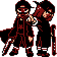

| Trainer | Team | Where |
|---|---|---|
| 18/17y | [CIKKAN](pokedex/016_CIKKAN.md) Lv7, [UBERBIRO](pokedex/017_UBERBIRO.md) Lv9 | Nostalgothia Gym |

## INMATE (AILEEN)

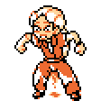

| Trainer | Team | Where |
|---|---|---|
| AILEEN | [OVARIAN](pokedex/192_OVARIAN.md) Lv18, [INTENSIVO](pokedex/241_INTENSIVO.md) Lv20 | Metro Complex Gym |

## INMATE (JEFFREY)

| Trainer | Team | Where |
|---|---|---|
| JEFFREY | [MUTAPUD](pokedex/011_MUTAPUD.md) Lv14, [KAKUZI](pokedex/014_KAKUZI.md) Lv14, [HANZORU](pokedex/123_HANZORU.md) Lv16 | Los Aura Gym |

## CULT LEADER

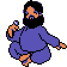

| Trainer | Team | Where |
|---|---|---|
| SHOKO | [GOSBAMP](pokedex/092_GOSBAMP.md) Lv21, [WRAITARL](pokedex/093_WRAITARL.md) Lv21, [TREROR](pokedex/094_TREROR.md) Lv25, [WRAITARL](pokedex/093_WRAITARL.md) Lv23 | Suburbia Gym |

## U.N.A.

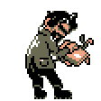

| Trainer | Team | Where |
|---|---|---|
| BOMBER | [MEGADIL](pokedex/086_MEGADIL.md) Lv27, [MEGADIL500](pokedex/087_MEGADIL500.md) Lv29, [PILOSWINE](pokedex/221_PILOSWINE.md) Lv31 | Lonely Woods Gym |

## JIHADIST

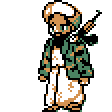

| Trainer | Team | Where |
|---|---|---|
| OSAMA | [GHOSHELLO](pokedex/081_GHOSHELLO.md) Lv30, [GHOSHELLO](pokedex/081_GHOSHELLO.md) Lv30, [HYDRAGYRUM](pokedex/208_HYDRAGYRUM.md) Lv35 | Government Gym |

## POGO CLOWN

| Trainer | Team | Where |
|---|---|---|
| GACY | [NAGASAK](pokedex/057_NAGASAK.md) Lv27, [SMEGMATIC](pokedex/062_SMEGMATIC.md) Lv30 | Oversea Asylum Gym |

## POPE

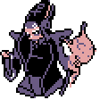

| Trainer | Team | Where |
|---|---|---|
| PLARIO | [SERAPHIUM](pokedex/148_SERAPHIUM.md) Lv37, [SERAPHIUM](pokedex/148_SERAPHIUM.md) Lv37, [SERAPHIUM](pokedex/148_SERAPHIUM.md) Lv37, [LUCIFERION](pokedex/006_LUCIFERION.md) Lv40 | Peak of Dread Gym 1F |

## NOIA AGENT

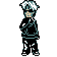

| Trainer | Team | Where |
|---|---|---|
| ? | [STRAMONIUM](pokedex/152_STRAMONIUM.md) Lv5 | Nearbytown |
| ? | [SCARFITO](pokedex/155_SCARFITO.md) Lv5 | Nearbytown |
| ? | [BONDILE](pokedex/158_BONDILE.md) Lv5 | Nearbytown |
| ? | [GOSBAMP](pokedex/092_GOSBAMP.md) Lv12, [GOTCHICK](pokedex/041_GOTCHICK.md) Lv14, [DIVINORUM](pokedex/153_DIVINORUM.md) Lv16 | Los Aura |
| ? | [GOSBAMP](pokedex/092_GOSBAMP.md) Lv12, [GOTCHICK](pokedex/041_GOTCHICK.md) Lv14, [CRUXADO](pokedex/156_CRUXADO.md) Lv16 | Los Aura |
| ? | [GOSBAMP](pokedex/092_GOSBAMP.md) Lv12, [GOTCHICK](pokedex/041_GOTCHICK.md) Lv14, [GAGOGO](pokedex/159_GAGOGO.md) Lv16 | Los Aura |
| ? | [WRAITARL](pokedex/093_WRAITARL.md) Lv20, [GHOSHELLO](pokedex/081_GHOSHELLO.md) Lv18, [GOTCHICK](pokedex/041_GOTCHICK.md) Lv20, [DIVINORUM](pokedex/153_DIVINORUM.md) Lv22 | Burned Tower 1F |
| ? | [WRAITARL](pokedex/093_WRAITARL.md) Lv20, [GHOSHELLO](pokedex/081_GHOSHELLO.md) Lv18, [GOTCHICK](pokedex/041_GOTCHICK.md) Lv20, [CRUXADO](pokedex/156_CRUXADO.md) Lv22 | Burned Tower 1F |
| ? | [WRAITARL](pokedex/093_WRAITARL.md) Lv20, [GHOSHELLO](pokedex/081_GHOSHELLO.md) Lv18, [GOTCHICK](pokedex/041_GOTCHICK.md) Lv20, [GAGOGO](pokedex/159_GAGOGO.md) Lv22 | Burned Tower 1F |
| ? | [VAMPESSA](pokedex/042_VAMPESSA.md) Lv30, [GHOSHELLO](pokedex/081_GHOSHELLO.md) Lv28, [WRAITARL](pokedex/093_WRAITARL.md) Lv30, [KUNOIGA](pokedex/215_KUNOIGA.md) Lv32, [AYAHUASCO](pokedex/154_AYAHUASCO.md) Lv32 | Metro Complex |
| ? | [VAMPESSA](pokedex/042_VAMPESSA.md) Lv30, [GHOSHELLO](pokedex/081_GHOSHELLO.md) Lv28, [WRAITARL](pokedex/093_WRAITARL.md) Lv30, [KUNOIGA](pokedex/215_KUNOIGA.md) Lv32, [CRUXADO](pokedex/156_CRUXADO.md) Lv32 | Metro Complex |
| ? | [VAMPESSA](pokedex/042_VAMPESSA.md) Lv30, [GHOSHELLO](pokedex/081_GHOSHELLO.md) Lv28, [WRAITARL](pokedex/093_WRAITARL.md) Lv30, [KUNOIGA](pokedex/215_KUNOIGA.md) Lv32, [CROCOSNUFF](pokedex/160_CROCOSNUFF.md) Lv32 | Metro Complex |
| ? | [KUNOIGA](pokedex/215_KUNOIGA.md) Lv34, [VAMPESSA](pokedex/042_VAMPESSA.md) Lv36, [SORAYAMBOT](pokedex/082_SORAYAMBOT.md) Lv35, [WRAITARL](pokedex/093_WRAITARL.md) Lv35, [PROFETUS](pokedex/064_PROFETUS.md) Lv35, [AYAHUASCO](pokedex/154_AYAHUASCO.md) Lv38 | Victory Road |
| ? | [KUNOIGA](pokedex/215_KUNOIGA.md) Lv34, [VAMPESSA](pokedex/042_VAMPESSA.md) Lv36, [SORAYAMBOT](pokedex/082_SORAYAMBOT.md) Lv35, [WRAITARL](pokedex/093_WRAITARL.md) Lv35, [PROFETUS](pokedex/064_PROFETUS.md) Lv35, [INFERNATUS](pokedex/157_INFERNATUS.md) Lv38 | Victory Road |
| ? | [KUNOIGA](pokedex/215_KUNOIGA.md) Lv34, [VAMPESSA](pokedex/042_VAMPESSA.md) Lv36, [SORAYAMBOT](pokedex/082_SORAYAMBOT.md) Lv34, [WRAITARL](pokedex/093_WRAITARL.md) Lv35, [PROFETUS](pokedex/064_PROFETUS.md) Lv35, [CROCOSNUFF](pokedex/160_CROCOSNUFF.md) Lv38 | Victory Road |

## POKéMON PROF.

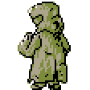

| Trainer | Team | Where |
|---|---|---|
| GATE | [QUELZALCOT](pokedex/178_QUELZALCOT.md) Lv40, [JYZZO](pokedex/124_JYZZO.md) Lv41, [MASKABUKI](pokedex/103_MASKABUKI.md) Lv41, [KORNUPIAK](pokedex/080_KORNUPIAK.md) Lv41, [QUELZALCOT](pokedex/178_QUELZALCOT.md) Lv42 |  |

## DIGITAL世界

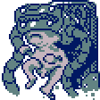

| Trainer | Team | Where |
|---|---|---|
| GATE | [QUELZALCOT](pokedex/178_QUELZALCOT.md) Lv40, [JYZZO](pokedex/124_JYZZO.md) Lv41, [MASKABUKI](pokedex/103_MASKABUKI.md) Lv41, [KORNUPIAK](pokedex/080_KORNUPIAK.md) Lv41, [QUELZALCOT](pokedex/178_QUELZALCOT.md) Lv42 | Indigo Plateau |

## PKMN TRAINER

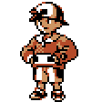

| Trainer | Team | Where |
|---|---|---|
| CAL | [STRAMONIUM](pokedex/152_STRAMONIUM.md) Lv10, [SCARFITO](pokedex/155_SCARFITO.md) Lv10, [BONDILE](pokedex/158_BONDILE.md) Lv10 |  |
| CAL | [DIVINORUM](pokedex/153_DIVINORUM.md) Lv30, [CRUXADO](pokedex/156_CRUXADO.md) Lv30, [GAGOGO](pokedex/159_GAGOGO.md) Lv30 | Viridian City B1F |
| CAL | [AYAHUASCO](pokedex/154_AYAHUASCO.md) Lv50, [INFERNATUS](pokedex/157_INFERNATUS.md) Lv50, [CROCOSNUFF](pokedex/160_CROCOSNUFF.md) Lv50 | Viridian City B1F |

## ELITE FOUR (BRUNO)

| Trainer | Team | Where |
|---|---|---|
| BRUNO | [JUTSUFAITA](pokedex/237_JUTSUFAITA.md) Lv42, [THAIFAITA](pokedex/106_THAIFAITA.md) Lv42, [MIKEFAITA](pokedex/107_MIKEFAITA.md) Lv42, [OBSIDIAN](pokedex/095_OBSIDIAN.md) Lv43, [KONGORISH](pokedex/068_KONGORISH.md) Lv46 | Indigo Plateau |

## ELITE FOUR (KAREN)

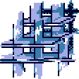

| Trainer | Team | Where |
|---|---|---|
| KAREN | [DAMNATEON](pokedex/197_DAMNATEON.md) Lv42, [LARSENEF](pokedex/045_LARSENEF.md) Lv42, [TREROR](pokedex/094_TREROR.md) Lv45, [SKARKROW](pokedex/198_SKARKROW.md) Lv44, [HOUNDOOM](pokedex/229_HOUNDOOM.md) Lv47 | Indigo Plateau |

## ELITE FOUR (KOGA)

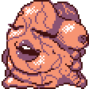

| Trainer | Team | Where |
|---|---|---|
| KOGA | [NAZITANK](pokedex/168_NAZITANK.md) Lv40, [CHORDYCEPS](pokedex/049_CHORDYCEPS.md) Lv41, [/NEURONET](pokedex/205_NEURONET.md) Lv43, [KUMORAH](pokedex/089_KUMORAH.md) Lv42, [TRIZOM](pokedex/169_TRIZOM.md) Lv44 | Indigo Plateau |

## PURE MATH

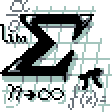

| Trainer | Team | Where |
|---|---|---|
| □□3cos(□ | [HANNYADOS](pokedex/130_HANNYADOS.md) Lv44, [CHILONGO](pokedex/149_CHILONGO.md) Lv47, [CHILONGO](pokedex/149_CHILONGO.md) Lv47, [PTEROXIS](pokedex/142_PTEROXIS.md) Lv46, [LUCIFERION](pokedex/006_LUCIFERION.md) Lv46, [CHILONGO](pokedex/149_CHILONGO.md) Lv50 | Indigo Plateau |

## LEADER (BROCK)

| Trainer | Team | Where |
|---|---|---|
| BROCK | [PLUTONIUM](pokedex/075_PLUTONIUM.md) Lv41, [ELICORPS](pokedex/111_ELICORPS.md) Lv41, [MECHANIGAL](pokedex/139_MECHANIGAL.md) Lv42, [OBSIDIAN](pokedex/095_OBSIDIAN.md) Lv44, [ZILOSNAK](pokedex/141_ZILOSNAK.md) Lv42 | Pewter City Gym |

## LEADER (MISTY)

| Trainer | Team | Where |
|---|---|---|
| MISTY | [DUKAKIS](pokedex/055_DUKAKIS.md) Lv42, [ASPHYXIAR](pokedex/195_ASPHYXIAR.md) Lv42, [KARONTIS](pokedex/131_KARONTIS.md) Lv44, [IRUKUNJI](pokedex/121_IRUKUNJI.md) Lv47 | Cerulean City Gym |

## LEADER (LT.SURGE)

| Trainer | Team | Where |
|---|---|---|
| LT.SURGE | [RAICHEWEDZ](pokedex/026_RAICHEWEDZ.md) Lv44, [NINGOGORE](pokedex/101_NINGOGORE.md) Lv40, [SORAYAMBOT](pokedex/082_SORAYAMBOT.md) Lv40, [NINGOGORE](pokedex/101_NINGOGORE.md) Lv40, [VOLCUTION](pokedex/125_VOLCUTION.md) Lv46 | Vermilion City Gym |

## SCIENTIST

| Trainer | Team | Where |
|---|---|---|
| ROSS | [SARSARAS](pokedex/109_SARSARAS.md) Lv22, [SARSARAS](pokedex/109_SARSARAS.md) Lv22 | Lonely Woods B3F |
| MITCH | [SHITTO](pokedex/132_SHITTO.md) Lv24 | Lonely Woods B3F |
| JED | [GHOSHELLO](pokedex/081_GHOSHELLO.md) Lv20, [GHOSHELLO](pokedex/081_GHOSHELLO.md) Lv20, [GHOSHELLO](pokedex/081_GHOSHELLO.md) Lv20 | Lonely Woods B1F |
| MARC | [GHOSHELLO](pokedex/081_GHOSHELLO.md) Lv27, [GHOSHELLO](pokedex/081_GHOSHELLO.md) Lv27, [GHOSHELLO](pokedex/081_GHOSHELLO.md) Lv27 | Radio Tower 3F |
| RICH | [TERMINALIX](pokedex/137_TERMINALIX.md) Lv30 | Radio Tower 4F |

## LEADER (ERIKA)

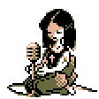

| Trainer | Team | Where |
|---|---|---|
| ERIKA | [WORMICELLI](pokedex/114_WORMICELLI.md) Lv42, [ITTIOSO](pokedex/189_ITTIOSO.md) Lv41, [NORIMBERGU](pokedex/071_NORIMBERGU.md) Lv46, [MANDELBRO](pokedex/182_MANDELBRO.md) Lv46 | Celadon City Gym |

## MENINO D RUA

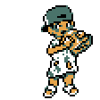

| Trainer | Team | Where |
|---|---|---|
| 12y | [FOGNUS](pokedex/019_FOGNUS.md) Lv4 | Area 30 |
| 13y | [CIKKAN](pokedex/016_CIKKAN.md) Lv2, [FOGNUS](pokedex/019_FOGNUS.md) Lv4 | Area 30 |
| ALBERT | [FOGNUS](pokedex/019_FOGNUS.md) Lv6, [GOTCHICK](pokedex/041_GOTCHICK.md) Lv8 | Area 32 |
| GORDON | [KOTZWAR](pokedex/194_KOTZWAR.md) Lv10 | Area 32 |
| SAMUEL | [FOGNUS](pokedex/019_FOGNUS.md) Lv7, [PAPYRYU](pokedex/027_PAPYRYU.md) Lv10, [SBLARFO](pokedex/021_SBLARFO.md) Lv8, [SBLARFO](pokedex/021_SBLARFO.md) Lv8 | Area 34 |
| IAN | [HIROOSH](pokedex/056_HIROOSH.md) Lv10, [KAZETTO](pokedex/050_KAZETTO.md) Lv12 | Area 34 |
| JOEY | [FOGNUS](pokedex/019_FOGNUS.md) Lv15 | Area 30 |
| JOEY | [RATOZZO](pokedex/020_RATOZZO.md) Lv21 | Area 30 |
| WARREN | [SGLARFO](pokedex/022_SGLARFO.md) Lv35 | Area 3 |
| JIMMY | [RATOZZO](pokedex/020_RATOZZO.md) Lv33, [URBOROK](pokedex/024_URBOROK.md) Lv33 | Area 3 |
| OWEN | [SCRATCHY](pokedex/058_SCRATCHY.md) Lv35 | Area 11 |
| JASON | [SPHINXO](pokedex/028_SPHINXO.md) Lv33, [TRIZOM](pokedex/169_TRIZOM.md) Lv33 | Area 11 |
| JOEY | [RATOZZO](pokedex/020_RATOZZO.md) Lv30 | Area 30 |
| JOEY | [RATOZZO](pokedex/020_RATOZZO.md) Lv37 | Area 30 |

## GOONER

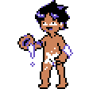

| Trainer | Team | Where |
|---|---|---|
| JACK | [ODDGLITCH](pokedex/043_ODDGLITCH.md) Lv12, [KOWARENING](pokedex/100_KOWARENING.md) Lv15 | National Park |
| KIPP | [KOWARENING](pokedex/100_KOWARENING.md) Lv27, [GHOSHELLO](pokedex/081_GHOSHELLO.md) Lv27, [KOWARENING](pokedex/100_KOWARENING.md) Lv31, [SORAYAMBOT](pokedex/082_SORAYAMBOT.md) Lv31 | Area 15 |
| ALAN | [WORMICELLI](pokedex/114_WORMICELLI.md) Lv16 | Area 36 |
| JOHNNY | [PILLORYD](pokedex/069_PILLORYD.md) Lv29, [GUILTYOTIN](pokedex/070_GUILTYOTIN.md) Lv31, [NORIMBERGU](pokedex/071_NORIMBERGU.md) Lv33 | Area 15 |
| DANNY | [JYZZO](pokedex/124_JYZZO.md) Lv31, [VOLCUTION](pokedex/125_VOLCUTION.md) Lv31, [BURNAR](pokedex/126_BURNAR.md) Lv31 | Area 1 |
| TOMMY | [QUELZALCOT](pokedex/178_QUELZALCOT.md) Lv32, [MARTIRUS](pokedex/065_MARTIRUS.md) Lv34 | Area 15 |
| DUDLEY | [ODDGLITCH](pokedex/043_ODDGLITCH.md) Lv35 | Area 25 |
| JOE | [WORMICELLI](pokedex/114_WORMICELLI.md) Lv33, [VENEREON](pokedex/134_VENEREON.md) Lv33 | Area 25 |
| BILLY | [PARASITO](pokedex/046_PARASITO.md) Lv27, [PARASITO](pokedex/046_PARASITO.md) Lv27, [PROLIFIK](pokedex/061_PROLIFIK.md) Lv27, [SHITTO](pokedex/132_SHITTO.md) Lv35 | Area 15 |
| CHAD | [MR.SHADOW](pokedex/122_MR_SHADOW.md) Lv19 | Area 38 |
| NATE | [FACISTA](pokedex/166_FACISTA.md) Lv32, [MASKABUKI](pokedex/103_MASKABUKI.md) Lv32 | Fast Ship B1F |
| RICKY | [MOLESTO](pokedex/190_MOLESTO.md) Lv32, [SHITTO](pokedex/132_SHITTO.md) Lv32 | Fast Ship B1F |
| JACK | [ODDGLITCH](pokedex/043_ODDGLITCH.md) Lv14, [KOWARENING](pokedex/100_KOWARENING.md) Lv17 | National Park |
| JACK | [INFECTO](pokedex/044_INFECTO.md) Lv28, [NINGOGORE](pokedex/101_NINGOGORE.md) Lv31 | National Park |
| ALAN | [WORMICELLI](pokedex/114_WORMICELLI.md) Lv17, [NAPALMYAN](pokedex/193_NAPALMYAN.md) Lv17 | Area 36 |
| ALAN | [SACRILUT](pokedex/177_SACRILUT.md) Lv20, [WORMICELLI](pokedex/114_WORMICELLI.md) Lv22, [ASPHYXIAR](pokedex/195_ASPHYXIAR.md) Lv20, [NAPALMYAN](pokedex/193_NAPALMYAN.md) Lv25 | Area 36 |
| CHAD | [MR.SHADOW](pokedex/122_MR_SHADOW.md) Lv19, [GHOSHELLO](pokedex/081_GHOSHELLO.md) Lv19 | Area 38 |
| CHAD | [MR.SHADOW](pokedex/122_MR_SHADOW.md) Lv27, [SORAYAMBOT](pokedex/082_SORAYAMBOT.md) Lv31 | Area 38 |
| JACK | [INFECTO](pokedex/044_INFECTO.md) Lv30, [SCRATCHY](pokedex/058_SCRATCHY.md) Lv33, [NINGOGORE](pokedex/101_NINGOGORE.md) Lv33 | National Park |
| JACK | [NINGOGORE](pokedex/101_NINGOGORE.md) Lv35, [SCRATCHY](pokedex/058_SCRATCHY.md) Lv35, [LARSENEF](pokedex/045_LARSENEF.md) Lv37 | National Park |
| ALAN | [SACRILUT](pokedex/177_SACRILUT.md) Lv27, [WORMICELLI](pokedex/114_WORMICELLI.md) Lv27, [ASPHYXIAR](pokedex/195_ASPHYXIAR.md) Lv30, [NAPALMYAN](pokedex/193_NAPALMYAN.md) Lv30 | Area 36 |
| ALAN | [QUELZALCOT](pokedex/178_QUELZALCOT.md) Lv35, [WORMICELLI](pokedex/114_WORMICELLI.md) Lv32, [NAPALMYAN](pokedex/193_NAPALMYAN.md) Lv32, [ASPHYXIAR](pokedex/195_ASPHYXIAR.md) Lv35 | Area 36 |
| CHAD | [MR.SHADOW](pokedex/122_MR_SHADOW.md) Lv30, [SORAYAMBOT](pokedex/082_SORAYAMBOT.md) Lv34 | Area 38 |
| CHAD | [MR.SHADOW](pokedex/122_MR_SHADOW.md) Lv34, [SORAYAMBOT](pokedex/082_SORAYAMBOT.md) Lv38 | Area 38 |

## MASS SHOOTER

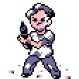

| Trainer | Team | Where |
|---|---|---|
| INCEL | [CIKKAN](pokedex/016_CIKKAN.md) Lv7, [CIKKAN](pokedex/016_CIKKAN.md) Lv7 | Nostalgothia Gym |
| INCEL | [SBLARFO](pokedex/021_SBLARFO.md) Lv9 | Nostalgothia Gym |
| INCEL | [CIKKAN](pokedex/016_CIKKAN.md) Lv12, [UBERBIRO](pokedex/017_UBERBIRO.md) Lv14 | Area 35 |
| INCEL | [CIKKAN](pokedex/016_CIKKAN.md) Lv17, [CIKKAN](pokedex/016_CIKKAN.md) Lv15, [CIKKAN](pokedex/016_CIKKAN.md) Lv19, [CIKKAN](pokedex/016_CIKKAN.md) Lv15, [CIKKAN](pokedex/016_CIKKAN.md) Lv15 | Pentafloor 3F |
| INCEL | [BIPOLARIO](pokedex/084_BIPOLARIO.md) Lv15, [BIPOLARIO](pokedex/084_BIPOLARIO.md) Lv16, [BIPOLARIO](pokedex/084_BIPOLARIO.md) Lv17 | Area 38 |
| INCEL | [SBLARFO](pokedex/021_SBLARFO.md) Lv18, [SGLARFO](pokedex/022_SGLARFO.md) Lv20, [SBLARFO](pokedex/021_SBLARFO.md) Lv18 | Pentafloor 5F |
| INCEL | [UBERBIRO](pokedex/017_UBERBIRO.md) Lv25, [UBERBIRO](pokedex/017_UBERBIRO.md) Lv25 | Area 44 |
| PTSD | [CIKKAN](pokedex/016_CIKKAN.md) Lv12, [HEPOCORPS](pokedex/018_HEPOCORPS.md) Lv34 | Area 4 |
| PTSD | [SGLARFO](pokedex/022_SGLARFO.md) Lv29, [SGLARFO](pokedex/022_SGLARFO.md) Lv35 | Area 14 |
| PTSD | [BIPOLARIO](pokedex/084_BIPOLARIO.md) Lv30, [BIPOLARIO](pokedex/084_BIPOLARIO.md) Lv28, [PSICOTO](pokedex/085_PSICOTO.md) Lv32 | Area 18 |
| PTSD | [ROBBINOWL](pokedex/164_ROBBINOWL.md) Lv34 | Area 18 |
| PTSD | [BONDAGEDOG](pokedex/083_BONDAGEDOG.md) Lv36 | Area 27 |
| INCEL | [CIKKAN](pokedex/016_CIKKAN.md) Lv6, [CIKKAN](pokedex/016_CIKKAN.md) Lv6, [SBLARFO](pokedex/021_SBLARFO.md) Lv8 | Area 32 |
| PTSD | [BONDAGEDOG](pokedex/083_BONDAGEDOG.md) Lv34 | Area 27 |
| PTSD | [BONDAGEDOG](pokedex/083_BONDAGEDOG.md) Lv34 | Area 13 |
| PTSD | [UBERBIRO](pokedex/017_UBERBIRO.md) Lv32, [SGLARFO](pokedex/022_SGLARFO.md) Lv32 | Area 13 |
| PTSD | [BONDAGEDOG](pokedex/083_BONDAGEDOG.md) Lv40 | Area 27 |
| PTSD | [UBERBIRO](pokedex/017_UBERBIRO.md) Lv32, [UBERBIRO](pokedex/017_UBERBIRO.md) Lv32 | Area 44 |
| PTSD | [HEPOCORPS](pokedex/018_HEPOCORPS.md) Lv38, [HEPOCORPS](pokedex/018_HEPOCORPS.md) Lv38 | Area 44 |

## FEMBOY

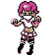

| Trainer | Team | Where |
|---|---|---|
| CARRIE | [BLEKHOLIA](pokedex/209_BLEKHOLIA.md) Lv18 | Metro Complex Gym |
| BRIDGET | [EYEBALLY](pokedex/039_EYEBALLY.md) Lv15, [EYEBALLY](pokedex/039_EYEBALLY.md) Lv15, [EYEBALLY](pokedex/039_EYEBALLY.md) Lv15 | Metro Complex Gym |
| ALICE | [INFECTO](pokedex/044_INFECTO.md) Lv30, [URBOROK](pokedex/024_URBOROK.md) Lv34, [INFECTO](pokedex/044_INFECTO.md) Lv30 | Fuchsia City Gym |
| KRISE | [ODDGLITCH](pokedex/043_ODDGLITCH.md) Lv12, [RIOTTO](pokedex/104_RIOTTO.md) Lv15 | National Park |
| CONNIE | [HALUAL](pokedex/183_HALUAL.md) Lv21 | Pentafloor 4F |
| LINDA | [WEEDAZOR](pokedex/001_WEEDAZOR.md) Lv30, [COCAZOR](pokedex/002_COCAZOR.md) Lv32, [OPIUMZOR](pokedex/003_OPIUMZOR.md) Lv34 | Fuchsia City Gym |
| LAURA | [INFECTO](pokedex/044_INFECTO.md) Lv28, [UBERBIRO](pokedex/017_UBERBIRO.md) Lv31, [MANDELBRO](pokedex/182_MANDELBRO.md) Lv31 | Area 25 |
| SHANNON | [PARASITO](pokedex/046_PARASITO.md) Lv29, [PARASITO](pokedex/046_PARASITO.md) Lv29, [PSILOCYBO](pokedex/047_PSILOCYBO.md) Lv32 | Area 25 |
| MICHELLE | [INCUBATO](pokedex/188_INCUBATO.md) Lv32, [ABORTITO](pokedex/187_ABORTITO.md) Lv33, [ITTIOSO](pokedex/189_ITTIOSO.md) Lv34 | Celadon City Gym |
| DANA | [ALGOCRAT](pokedex/180_ALGOCRAT.md) Lv18, [WORMACK](pokedex/054_WORMACK.md) Lv18 | Area 38 |
| ELLEN | [KAWAIKAGO](pokedex/040_KAWAIKAGO.md) Lv30, [GALAXIAN](pokedex/210_GALAXIAN.md) Lv34 | Area 25 |
| CONNIE | [HALUAL](pokedex/183_HALUAL.md) Lv21 |  |
| CONNIE | [HALUAL](pokedex/183_HALUAL.md) Lv21 |  |
| DANA | [ALGOCRAT](pokedex/180_ALGOCRAT.md) Lv21, [WORMACK](pokedex/054_WORMACK.md) Lv21 | Area 38 |
| DANA | [WORMACK](pokedex/054_WORMACK.md) Lv29, [DICTAITOR](pokedex/181_DICTAITOR.md) Lv29 | Area 38 |
| DANA | [WORMACK](pokedex/054_WORMACK.md) Lv32, [DICTAITOR](pokedex/181_DICTAITOR.md) Lv32 | Area 38 |
| DANA | [DICTAITOR](pokedex/181_DICTAITOR.md) Lv36, [DUKAKIS](pokedex/055_DUKAKIS.md) Lv36 | Area 38 |

## LEADER (JANINE)

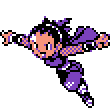

| Trainer | Team | Where |
|---|---|---|
| JANINE | [TRIZOM](pokedex/169_TRIZOM.md) Lv36, [LUNGANSER](pokedex/110_LUNGANSER.md) Lv36, [LUNGANSER](pokedex/110_LUNGANSER.md) Lv36, [NAZITANK](pokedex/168_NAZITANK.md) Lv33, [CHORDYCEPS](pokedex/049_CHORDYCEPS.md) Lv39 | Fuchsia City Gym |

## COOLTRAINER (NICK, AARON, …)

| Trainer | Team | Where |
|---|---|---|
| NICK | [CHARMHELL](pokedex/004_CHARMHELL.md) Lv26, [SCOLINA](pokedex/007_SCOLINA.md) Lv26, [WEEDAZOR](pokedex/001_WEEDAZOR.md) Lv26 | Union Cave B2F |
| AARON | [COCAZOR](pokedex/002_COCAZOR.md) Lv24, [BELIALEON](pokedex/005_BELIALEON.md) Lv24, [SCOLANO](pokedex/008_SCOLANO.md) Lv24 | Source of Plasma |
| PAUL | [CHERUBIUM](pokedex/147_CHERUBIUM.md) Lv34, [CHERUBIUM](pokedex/147_CHERUBIUM.md) Lv34, [CHERUBIUM](pokedex/147_CHERUBIUM.md) Lv34 | Peak of Dread Gym 1F |
| CODY | [COCKY](pokedex/116_COCKY.md) Lv34, [SCROTRA](pokedex/117_SCROTRA.md) Lv36 | Peak of Dread Gym 2F |
| MIKE | [SERAPHIUM](pokedex/148_SERAPHIUM.md) Lv37 | Peak of Dread Gym 1F |
| GAVEN | [NORIMBERGU](pokedex/071_NORIMBERGU.md) Lv35, [NUKEBARL](pokedex/099_NUKEBARL.md) Lv35, [CERBERION](pokedex/136_CERBERION.md) Lv35 | Area 26 |
| GAVEN | [NORIMBERGU](pokedex/071_NORIMBERGU.md) Lv39, [NUKEBARL](pokedex/099_NUKEBARL.md) Lv39, [CERBERION](pokedex/136_CERBERION.md) Lv39 | Area 26 |
| RYAN | [HEPOCORPS](pokedex/018_HEPOCORPS.md) Lv25, [VOLCUTION](pokedex/125_VOLCUTION.md) Lv27 | Area 45 |
| JAKE | [PSILOCYBO](pokedex/047_PSILOCYBO.md) Lv33, [DUKAKIS](pokedex/055_DUKAKIS.md) Lv35 | Area 26 |
| GAVEN | [NORIMBERGU](pokedex/071_NORIMBERGU.md) Lv32, [NUKEBARL](pokedex/099_NUKEBARL.md) Lv32, [CERBERION](pokedex/136_CERBERION.md) Lv32 | Area 26 |
| BLAKE | [SORAYAMBOT](pokedex/082_SORAYAMBOT.md) Lv33, [ASPHYXIAR](pokedex/195_ASPHYXIAR.md) Lv31, [DARUMORT](pokedex/102_DARUMORT.md) Lv31 | Area 27 |
| BRIAN | [SPHINXO](pokedex/028_SPHINXO.md) Lv35 | Area 27 |
| ERICK | [WEEDAZOR](pokedex/001_WEEDAZOR.md) Lv10, [CHARMHELL](pokedex/004_CHARMHELL.md) Lv10, [SCOLINA](pokedex/007_SCOLINA.md) Lv10 |  |
| ANDY | [WEEDAZOR](pokedex/001_WEEDAZOR.md) Lv10, [CHARMHELL](pokedex/004_CHARMHELL.md) Lv10, [SCOLINA](pokedex/007_SCOLINA.md) Lv10 |  |
| TYLER | [WEEDAZOR](pokedex/001_WEEDAZOR.md) Lv10, [CHARMHELL](pokedex/004_CHARMHELL.md) Lv10, [SCOLINA](pokedex/007_SCOLINA.md) Lv10 |  |
| SEAN | [CERBERION](pokedex/136_CERBERION.md) Lv35, [WORMICELLI](pokedex/114_WORMICELLI.md) Lv35, [DIGESTOR](pokedex/128_DIGESTOR.md) Lv35 | Fast Ship |
| KEVIN | [ELICORPS](pokedex/111_ELICORPS.md) Lv38, [BELIALEON](pokedex/005_BELIALEON.md) Lv35, [SCOLANO](pokedex/008_SCOLANO.md) Lv35 | Area 25 |
| STEVE | [WEEDAZOR](pokedex/001_WEEDAZOR.md) Lv14, [CHARMHELL](pokedex/004_CHARMHELL.md) Lv14, [SCOLINA](pokedex/007_SCOLINA.md) Lv14 |  |
| ALLEN | [BELIALEON](pokedex/005_BELIALEON.md) Lv27 | Area 44 |
| DARIN | [SERAPHIUM](pokedex/148_SERAPHIUM.md) Lv37 | Dragon's Den B1F |

## COOLTRAINER (GWEN, LOIS, …)

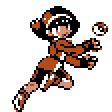

| Trainer | Team | Where |
|---|---|---|
| GWEN | [DEADDOG](pokedex/133_DEADDOG.md) Lv26, [CERBERION](pokedex/136_CERBERION.md) Lv22, [VENEREON](pokedex/134_VENEREON.md) Lv22, [NUKENION](pokedex/135_NUKENION.md) Lv22 | Union Cave B2F |
| LOIS | [INCUBATO](pokedex/188_INCUBATO.md) Lv25, [KITSUNAIL](pokedex/038_KITSUNAIL.md) Lv25 | Source of Plasma |
| FRAN | [SCROTRA](pokedex/117_SCROTRA.md) Lv37 | Peak of Dread Gym 2F |
| LOLA | [CHERUBIUM](pokedex/147_CHERUBIUM.md) Lv34, [SERAPHIUM](pokedex/148_SERAPHIUM.md) Lv36 | Peak of Dread Gym 1F |
| KATE | [SHELLDER](pokedex/090_SHELLDER.md) Lv26, [VAGINDAM](pokedex/091_VAGINDAM.md) Lv28 | Area 34 |
| IRENE | [BLINKY](pokedex/118_BLINKY.md) Lv22, [HOGEROT](pokedex/119_HOGEROT.md) Lv24 | Area 34 |
| KELLY | [HALUAL](pokedex/183_HALUAL.md) Lv27, [SCOLANO](pokedex/008_SCOLANO.md) Lv24, [SCOLANO](pokedex/008_SCOLANO.md) Lv24 | Area 45 |
| JOYCE | [PIKACHEWED](pokedex/025_PIKACHEWED.md) Lv36, [SCOLENE](pokedex/009_SCOLENE.md) Lv32 | Area 26 |
| BETH | [FAXHIRO](pokedex/078_FAXHIRO.md) Lv36 | Area 26 |
| REENA | [IRUKUNJI](pokedex/121_IRUKUNJI.md) Lv31, [KALEDENDS](pokedex/031_KALEDENDS.md) Lv33, [IRUKUNJI](pokedex/121_IRUKUNJI.md) Lv31 | Area 27 |
| MEGAN | [WEEDAZOR](pokedex/001_WEEDAZOR.md) Lv32, [COCAZOR](pokedex/002_COCAZOR.md) Lv32, [OPIUMZOR](pokedex/003_OPIUMZOR.md) Lv32 | Area 27 |
| BETH | [FAXHIRO](pokedex/078_FAXHIRO.md) Lv39 | Area 26 |
| CAROL | [NINGOGORE](pokedex/101_NINGOGORE.md) Lv35, [IRUKUNJI](pokedex/121_IRUKUNJI.md) Lv35, [KITSUNAIL](pokedex/038_KITSUNAIL.md) Lv35 | Fast Ship |
| QUINN | [COCAZOR](pokedex/002_COCAZOR.md) Lv38, [IRUKUNJI](pokedex/121_IRUKUNJI.md) Lv38 | Area 1 |
| EMMA | [PROLIFIK](pokedex/061_PROLIFIK.md) Lv28 | Union Cave B2F |
| CYBIL | [MONASIGHT](pokedex/012_MONASIGHT.md) Lv25, [MANDELBRO](pokedex/182_MANDELBRO.md) Lv25 | Area 44 |
| JENN | [MALOKINGI](pokedex/120_MALOKINGI.md) Lv24, [IRUKUNJI](pokedex/121_IRUKUNJI.md) Lv26 | Area 34 |
| BETH | [FAXHIRO](pokedex/078_FAXHIRO.md) Lv43 | Area 26 |
| REENA | [IRUKUNJI](pokedex/121_IRUKUNJI.md) Lv34, [KALEDENDS](pokedex/031_KALEDENDS.md) Lv36, [IRUKUNJI](pokedex/121_IRUKUNJI.md) Lv34 | Area 27 |
| REENA | [IRUKUNJI](pokedex/121_IRUKUNJI.md) Lv38, [KALEDENDS](pokedex/031_KALEDENDS.md) Lv40, [IRUKUNJI](pokedex/121_IRUKUNJI.md) Lv38 | Area 27 |
| CARA | [COCKY](pokedex/116_COCKY.md) Lv33, [COCKY](pokedex/116_COCKY.md) Lv33, [SCROTRA](pokedex/117_SCROTRA.md) Lv35 | Dragon's Den B1F |

## E-GIRL

| Trainer | Team | Where |
|---|---|---|
| VICTORIA | [BURQO](pokedex/161_BURQO.md) Lv9, [BURQO](pokedex/161_BURQO.md) Lv13, [BURQO](pokedex/161_BURQO.md) Lv17 | Metro Complex Gym |
| SAMANTHA | [NIGGA](pokedex/052_NIGGA.md) Lv16, [NIGGA](pokedex/052_NIGGA.md) Lv16 | Metro Complex Gym |
| JULIE | [BURQO](pokedex/161_BURQO.md) Lv15 |  |
| JACLYN | [BURQO](pokedex/161_BURQO.md) Lv15 |  |
| BRENDA | [JIHADO](pokedex/162_JIHADO.md) Lv16 |  |
| CASSIE | [LARSENEF](pokedex/045_LARSENEF.md) Lv28, [MONASIGHT](pokedex/012_MONASIGHT.md) Lv34 | Fast Ship |
| CAROLINE | [HALUAL](pokedex/183_HALUAL.md) Lv30, [MEGADIL](pokedex/086_MEGADIL.md) Lv32, [HALUAL](pokedex/183_HALUAL.md) Lv30 |  |
| CARLENE | [BURQO](pokedex/161_BURQO.md) Lv15 |  |
| JESSICA | [BURQO](pokedex/161_BURQO.md) Lv15 |  |
| RACHAEL | [BURQO](pokedex/161_BURQO.md) Lv15 |  |
| ANGELICA | [BURQO](pokedex/161_BURQO.md) Lv15 |  |
| KENDRA | [BURQO](pokedex/161_BURQO.md) Lv15 |  |
| VERONICA | [BURQO](pokedex/161_BURQO.md) Lv15 |  |
| JULIA | [PARASITO](pokedex/046_PARASITO.md) Lv32, [DARUMORT](pokedex/102_DARUMORT.md) Lv32, [PSILOCYBO](pokedex/047_PSILOCYBO.md) Lv35 | Celadon City Gym |
| THERESA | [BURQO](pokedex/161_BURQO.md) Lv15 |  |
| VALERIE | [ABORTITO](pokedex/187_ABORTITO.md) Lv17, [INCUBATO](pokedex/188_INCUBATO.md) Lv17 | Area 38 |
| OLIVIA | [NEURAPSYS](pokedex/222_NEURAPSYS.md) Lv19 | Area 38 |

## FENTANYL

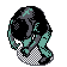

| Trainer | Team | Where |
|---|---|---|
| 0.02 mg | [SLOWGHOST](pokedex/079_SLOWGHOST.md) Lv10 | Union Cave 1F |
| 0.08 mg | [TERORISTO](pokedex/105_TERORISTO.md) Lv24, [TERORISTO](pokedex/105_TERORISTO.md) Lv24 | Union Cave B1F |
| 0.1 mg | [HELLTECH](pokedex/115_HELLTECH.md) Lv26 | Union Cave B1F |
| 0.02 mg | [HANDA](pokedex/030_HANDA.md) Lv16, [GRABOIDO](pokedex/033_GRABOIDO.md) Lv16 | Area 42 |
| 0.02 mg | [KORNUPIAK](pokedex/080_KORNUPIAK.md) Lv19 | Area 43 |
| 0.02 mg | [PUKALOT](pokedex/108_PUKALOT.md) Lv19 | Area 43 |
| 0.02 mg | [KESARUS](pokedex/034_KESARUS.md) Lv19 | Area 43 |
| 0.1 mg | [ELICORPS](pokedex/111_ELICORPS.md) Lv31, [MEDUCUNT](pokedex/112_MEDUCUNT.md) Lv31 | Fast Ship |
| 0.1 mg | [HELLTECH](pokedex/115_HELLTECH.md) Lv25 | Area 43 |
| 0.3 mg | [TERMINALIX](pokedex/137_TERMINALIX.md) Lv36 | Area 43 |
| 0.1 mg | [PUKALOT](pokedex/108_PUKALOT.md) Lv12 | Metro Complex |
| 0.02 mg | [SLOWGHOST](pokedex/079_SLOWGHOST.md) Lv10, [SLOWGHOST](pokedex/079_SLOWGHOST.md) Lv10 | Metro Complex |
| 0.1 mg | [ELICORPS](pokedex/111_ELICORPS.md) Lv27 | Area 44 |
| 1 mg | [PREGNANTA](pokedex/113_PREGNANTA.md) Lv41 | Area 43 |
| 0.1 mg | [KESARUS](pokedex/034_KESARUS.md) Lv17, [KALEDENDS](pokedex/031_KALEDENDS.md) Lv17 | Mt.Mortar 1F |

## PLAGUEcorp.

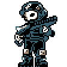

| Trainer | Team | Where |
|---|---|---|
| POLICE | [SARSARAS](pokedex/109_SARSARAS.md) Lv14 | Slowpoke Well B1F |
| POLICE | [FOGNUS](pokedex/019_FOGNUS.md) Lv7, [GOTCHICK](pokedex/041_GOTCHICK.md) Lv9, [GOTCHICK](pokedex/041_GOTCHICK.md) Lv9 | Slowpoke Well B1F |
| POLICE | [RATOZZO](pokedex/020_RATOZZO.md) Lv24, [RATOZZO](pokedex/020_RATOZZO.md) Lv24 | Radio Tower 1F |
| POLICE | [GRINDED](pokedex/088_GRINDED.md) Lv23, [GRINDED](pokedex/088_GRINDED.md) Lv23, [KUMORAH](pokedex/089_KUMORAH.md) Lv25 | Radio Tower 2F |
| POLICE | [FOGNUS](pokedex/019_FOGNUS.md) Lv21, [FOGNUS](pokedex/019_FOGNUS.md) Lv21, [FOGNUS](pokedex/019_FOGNUS.md) Lv23, [FOGNUS](pokedex/019_FOGNUS.md) Lv23, [FOGNUS](pokedex/019_FOGNUS.md) Lv23 | Radio Tower 2F |
| POLICE | [GOTCHICK](pokedex/041_GOTCHICK.md) Lv26, [GOTCHICK](pokedex/041_GOTCHICK.md) Lv26 | Radio Tower 2F |
| POLICE | [SARSARAS](pokedex/109_SARSARAS.md) Lv23, [GRINDED](pokedex/088_GRINDED.md) Lv23, [GOTCHICK](pokedex/041_GOTCHICK.md) Lv23, [FOGNUS](pokedex/019_FOGNUS.md) Lv23 | Radio Tower 3F |
| POLICE | [LUNGANSER](pokedex/110_LUNGANSER.md) Lv26 | Radio Tower 3F |
| POLICE | [RATOZZO](pokedex/020_RATOZZO.md) Lv24, [SARSARAS](pokedex/109_SARSARAS.md) Lv26 | Radio Tower 3F |
| POLICE | [GOTCHICK](pokedex/041_GOTCHICK.md) Lv22, [VAMPESSA](pokedex/042_VAMPESSA.md) Lv24, [GRINDED](pokedex/088_GRINDED.md) Lv22 | Radio Tower 4F |
| POLICE | [KUMORAH](pokedex/089_KUMORAH.md) Lv23, [SARSARAS](pokedex/109_SARSARAS.md) Lv23, [FOGNUS](pokedex/019_FOGNUS.md) Lv25 | Metro Complex |
| EXECUTIVE | [HOUNDOUR](pokedex/228_HOUNDOUR.md) Lv33 |  |
| POLICE | [FOGNUS](pokedex/019_FOGNUS.md) Lv27 | Metro Complex |
| POLICE | [RATOZZO](pokedex/020_RATOZZO.md) Lv24, [VAMPESSA](pokedex/042_VAMPESSA.md) Lv24 | Metro Complex |
| POLICE | [GRINDED](pokedex/088_GRINDED.md) Lv26, [LUNGANSER](pokedex/110_LUNGANSER.md) Lv23 | Metro Complex |
| POLICE | [FOGNUS](pokedex/019_FOGNUS.md) Lv16, [FOGNUS](pokedex/019_FOGNUS.md) Lv16, [FOGNUS](pokedex/019_FOGNUS.md) Lv16, [FOGNUS](pokedex/019_FOGNUS.md) Lv16 | Lonely Woods B1F |
| POLICE | [VAMPESSA](pokedex/042_VAMPESSA.md) Lv18 | Lonely Woods B2F |
| POLICE | [FOGNUS](pokedex/019_FOGNUS.md) Lv17, [GOTCHICK](pokedex/041_GOTCHICK.md) Lv17, [FOGNUS](pokedex/019_FOGNUS.md) Lv17 | Lonely Woods B2F |
| POLICE | [GNAKGNAK](pokedex/048_GNAKGNAK.md) Lv18, [GNAKGNAK](pokedex/048_GNAKGNAK.md) Lv18 | Lonely Woods B2F |
| POLICE | [DUPUPETT](pokedex/096_DUPUPETT.md) Lv17, [GOTCHICK](pokedex/041_GOTCHICK.md) Lv19 | Lonely Woods B1F |
| POLICE | [GOTCHICK](pokedex/041_GOTCHICK.md) Lv16, [GRINDED](pokedex/088_GRINDED.md) Lv17, [FOGNUS](pokedex/019_FOGNUS.md) Lv18 | Lonely Woods B1F |
| EXECUTIVE | [VAMPESSA](pokedex/042_VAMPESSA.md) Lv36 |  |
| EXECUTIVE | [SARSARAS](pokedex/109_SARSARAS.md) Lv30 |  |
| POLICE | [SARSARAS](pokedex/109_SARSARAS.md) Lv25, [SARSARAS](pokedex/109_SARSARAS.md) Lv25 | Metro Complex |
| POLICE | [SARSARAS](pokedex/109_SARSARAS.md) Lv24, [KUMORAH](pokedex/089_KUMORAH.md) Lv24 | Metro Complex |
| POLICE | [FOGNUS](pokedex/019_FOGNUS.md) Lv15, [FOGNUS](pokedex/019_FOGNUS.md) Lv15 |  |
| EXECUTIVE | [GOTCHICK](pokedex/041_GOTCHICK.md) Lv22 |  |
| POLICE | [RATOZZO](pokedex/020_RATOZZO.md) Lv19 | Lonely Woods B3F |
| POLICE | [FOGNUS](pokedex/019_FOGNUS.md) Lv9, [FOGNUS](pokedex/019_FOGNUS.md) Lv9 | Slowpoke Well B1F |
| POLICE | [VAMPESSA](pokedex/042_VAMPESSA.md) Lv25, [VAMPESSA](pokedex/042_VAMPESSA.md) Lv25, [URBOROK](pokedex/024_URBOROK.md) Lv30 |  |
| POLICE | [VAMPESSA](pokedex/042_VAMPESSA.md) Lv30 | Area 24 |

## REPTILIAN

| Trainer | Team | Where |
|---|---|---|
| JEW | [SCRATCHY](pokedex/058_SCRATCHY.md) Lv18, [SCRATCHY](pokedex/058_SCRATCHY.md) Lv18 | Pentafloor 3F |
| JEW | [TENKA](pokedex/053_TENKA.md) Lv33 | Fast Ship |
| JEW | [PIKACHEWED](pokedex/025_PIKACHEWED.md) Lv37, [ALGOCRAT](pokedex/180_ALGOCRAT.md) Lv33 | Vermilion City Gym |
| JEW | [HELLESTO](pokedex/077_HELLESTO.md) Lv20 |  |
| JEW | [ROBBINOWL](pokedex/164_ROBBINOWL.md) Lv20 | Pentafloor 2F |

## SKIER

| Trainer | Team | Where |
|---|---|---|
| ROXANNE | [JYZZO](pokedex/124_JYZZO.md) Lv28 | Lonely Woods Gym |
| CLARISSA | [MEGADIL500](pokedex/087_MEGADIL500.md) Lv28 | Lonely Woods Gym |

## TEACHER

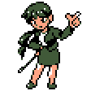

| Trainer | Team | Where |
|---|---|---|
| COLETTE | [CRISTALIA](pokedex/035_CRISTALIA.md) Lv36 | Area 15 |
| HILLARY | [MOLESTO](pokedex/190_MOLESTO.md) Lv32, [RIOTTO](pokedex/104_RIOTTO.md) Lv36 | Area 15 |
| SHIRLEY | [EYEBALLY](pokedex/039_EYEBALLY.md) Lv35 | Fast Ship B1F |

## LEADER (SABRINA)

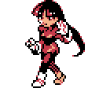

| Trainer | Team | Where |
|---|---|---|
| SABRINA | [EMBRYEON](pokedex/196_EMBRYEON.md) Lv46, [MR.SHADOW](pokedex/122_MR_SHADOW.md) Lv46, [MARTIRUS](pokedex/065_MARTIRUS.md) Lv48 | Saffron City Gym |

## MARANZA

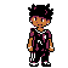

| Trainer | Team | Where |
|---|---|---|
| AHMED | [GUNBAG](pokedex/010_GUNBAG.md) Lv3, [GUNBAG](pokedex/010_GUNBAG.md) Lv3 | Area 30 |
| MOHAMD | [CAMOGATL](pokedex/015_CAMOGATL.md) Lv32, [MONASIGHT](pokedex/012_MONASIGHT.md) Lv32 | Area 2 |
| MOHAMD | [CAMOGATL](pokedex/015_CAMOGATL.md) Lv30, [CAMOGATL](pokedex/015_CAMOGATL.md) Lv30, [CAMOGATL](pokedex/015_CAMOGATL.md) Lv30 | Area 2 |
| HABIB | [GUNBAG](pokedex/010_GUNBAG.md) Lv2, [GUNBAG](pokedex/010_GUNBAG.md) Lv2, [WERMIX](pokedex/013_WERMIX.md) Lv3, [GUNBAG](pokedex/010_GUNBAG.md) Lv2 | Area 31 |
| HABIB | [WERMIX](pokedex/013_WERMIX.md) Lv7, [KAKUZI](pokedex/014_KAKUZI.md) Lv9, [CAMOGATL](pokedex/015_CAMOGATL.md) Lv12 | Los Aura Gym |
| HABIB | [GUNBAG](pokedex/010_GUNBAG.md) Lv12, [WERMIX](pokedex/013_WERMIX.md) Lv12 | Los Aura Gym |
| KHALED | [PARASITO](pokedex/046_PARASITO.md) Lv13 | Los Aura Gym |
| MOHAMD | [GNAKGNAK](pokedex/048_GNAKGNAK.md) Lv15 | Area 35 |
| MOHAMD | [NAZITANK](pokedex/168_NAZITANK.md) Lv30, [SHAMABOO](pokedex/127_SHAMABOO.md) Lv32 | Fast Ship |
| MOHAMD | [MUTAPUD](pokedex/011_MUTAPUD.md) Lv9, [MUTAPUD](pokedex/011_MUTAPUD.md) Lv9, [KAKUZI](pokedex/014_KAKUZI.md) Lv10, [MUTAPUD](pokedex/011_MUTAPUD.md) Lv9 | Area 31 |
| KHALED | [MONASIGHT](pokedex/012_MONASIGHT.md) Lv14, [MONASIGHT](pokedex/012_MONASIGHT.md) Lv14, [CAMOGATL](pokedex/015_CAMOGATL.md) Lv15, [MONASIGHT](pokedex/012_MONASIGHT.md) Lv14 | Area 31 |
| AZIZ | [NAZITANK](pokedex/168_NAZITANK.md) Lv34 | Area 2 |
| KHALED | [GNAKGNAK](pokedex/048_GNAKGNAK.md) Lv19 | Area 35 |
| AZIZ | [CHORDYCEPS](pokedex/049_CHORDYCEPS.md) Lv28 | Area 35 |
| AZIZ | [MONASIGHT](pokedex/012_MONASIGHT.md) Lv24, [MONASIGHT](pokedex/012_MONASIGHT.md) Lv24, [CAMOGATL](pokedex/015_CAMOGATL.md) Lv25, [MONASIGHT](pokedex/012_MONASIGHT.md) Lv24 | Area 31 |
| AZIZ | [MONASIGHT](pokedex/012_MONASIGHT.md) Lv30, [MONASIGHT](pokedex/012_MONASIGHT.md) Lv30, [CAMOGATL](pokedex/015_CAMOGATL.md) Lv32, [MONASIGHT](pokedex/012_MONASIGHT.md) Lv34 | Area 31 |
| AZIZ | [CHORDYCEPS](pokedex/049_CHORDYCEPS.md) Lv36 | Area 35 |
| MARIO | [CHORDYCEPS](pokedex/049_CHORDYCEPS.md) Lv40 | Area 35 |
| HABIB | [SBIRETTO](pokedex/165_SBIRETTO.md) Lv8, [PARASITO](pokedex/046_PARASITO.md) Lv10 | Suicide Forest |

## FISHER

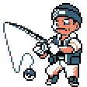

| Trainer | Team | Where |
|---|---|---|
| JUSTIN | [ROKUJOSHI](pokedex/129_ROKUJOSHI.md) Lv5, [ROKUJOSHI](pokedex/129_ROKUJOSHI.md) Lv5, [ROKUJOSHI](pokedex/129_ROKUJOSHI.md) Lv15, [ROKUJOSHI](pokedex/129_ROKUJOSHI.md) Lv5 | Area 32 |
| RALPH | [BLINKY](pokedex/118_BLINKY.md) Lv10 | Area 32 |
| ARNOLD | [HENTAIGORE](pokedex/073_HENTAIGORE.md) Lv34 | Area 21 |
| KYLE | [HOGEROT](pokedex/119_HOGEROT.md) Lv28, [PROLIFIK](pokedex/061_PROLIFIK.md) Lv31, [HOGEROT](pokedex/119_HOGEROT.md) Lv31 | Area 12 |
| HENRY | [SPERMOTZ](pokedex/060_SPERMOTZ.md) Lv8, [SPERMOTZ](pokedex/060_SPERMOTZ.md) Lv8 | Area 32 |
| MARVIN | [ROKUJOSHI](pokedex/129_ROKUJOSHI.md) Lv10, [HANNYADOS](pokedex/130_HANNYADOS.md) Lv10, [ROKUJOSHI](pokedex/129_ROKUJOSHI.md) Lv15, [HANNYADOS](pokedex/130_HANNYADOS.md) Lv15 | Area 43 |
| TULLY | [NAVALMINO](pokedex/211_NAVALMINO.md) Lv18 | Area 42 |
| ANDRE | [HANNYADOS](pokedex/130_HANNYADOS.md) Lv27 | Source of Plasma |
| RAYMOND | [ROKUJOSHI](pokedex/129_ROKUJOSHI.md) Lv22, [ROKUJOSHI](pokedex/129_ROKUJOSHI.md) Lv22, [ROKUJOSHI](pokedex/129_ROKUJOSHI.md) Lv22, [ROKUJOSHI](pokedex/129_ROKUJOSHI.md) Lv22 | Source of Plasma |
| WILTON | [BLINKY](pokedex/118_BLINKY.md) Lv23, [BLINKY](pokedex/118_BLINKY.md) Lv23, [HOGEROT](pokedex/119_HOGEROT.md) Lv25 | Area 44 |
| EDGAR | [ANIFISH](pokedex/223_ANIFISH.md) Lv25, [ANIFISH](pokedex/223_ANIFISH.md) Lv25 | Area 44 |
| JONAH | [SHELLDER](pokedex/090_SHELLDER.md) Lv25, [TOSHIOKI](pokedex/224_TOSHIOKI.md) Lv29, [ANIFISH](pokedex/223_ANIFISH.md) Lv25, [VAGINDAM](pokedex/091_VAGINDAM.md) Lv29 | Fast Ship B1F |
| MARTIN | [ANIFISH](pokedex/223_ANIFISH.md) Lv32, [ANIFISH](pokedex/223_ANIFISH.md) Lv32 | Area 12 |
| STEPHEN | [ROKUJOSHI](pokedex/129_ROKUJOSHI.md) Lv25, [ROKUJOSHI](pokedex/129_ROKUJOSHI.md) Lv25, [NAVALMINO](pokedex/211_NAVALMINO.md) Lv31, [HENTAIGORE](pokedex/073_HENTAIGORE.md) Lv31 | Area 12 |
| BARNEY | [HANNYADOS](pokedex/130_HANNYADOS.md) Lv30, [HANNYADOS](pokedex/130_HANNYADOS.md) Lv30, [HANNYADOS](pokedex/130_HANNYADOS.md) Lv30 | Area 12 |
| RALPH | [BLINKY](pokedex/118_BLINKY.md) Lv17 | Area 32 |
| RALPH | [NAVALMINO](pokedex/211_NAVALMINO.md) Lv17, [BLINKY](pokedex/118_BLINKY.md) Lv19 | Area 32 |
| TULLY | [NAVALMINO](pokedex/211_NAVALMINO.md) Lv23 | Area 42 |
| TULLY | [BLINKY](pokedex/118_BLINKY.md) Lv32, [BLINKY](pokedex/118_BLINKY.md) Lv32, [NAVALMINO](pokedex/211_NAVALMINO.md) Lv32 | Area 42 |
| WILTON | [BLINKY](pokedex/118_BLINKY.md) Lv29, [BLINKY](pokedex/118_BLINKY.md) Lv29, [HOGEROT](pokedex/119_HOGEROT.md) Lv32 | Area 44 |
| SCOTT | [NAVALMINO](pokedex/211_NAVALMINO.md) Lv30, [NAVALMINO](pokedex/211_NAVALMINO.md) Lv30, [HOGEROT](pokedex/119_HOGEROT.md) Lv34 | Area 26 |
| WILTON | [HOGEROT](pokedex/119_HOGEROT.md) Lv34, [HOGEROT](pokedex/119_HOGEROT.md) Lv34, [ANIFISH](pokedex/223_ANIFISH.md) Lv38 | Area 44 |
| RALPH | [NAVALMINO](pokedex/211_NAVALMINO.md) Lv30, [BLINKY](pokedex/118_BLINKY.md) Lv32 | Area 32 |
| RALPH | [NAVALMINO](pokedex/211_NAVALMINO.md) Lv35, [HOGEROT](pokedex/119_HOGEROT.md) Lv39 | Area 32 |
| TULLY | [HOGEROT](pokedex/119_HOGEROT.md) Lv34, [HOGEROT](pokedex/119_HOGEROT.md) Lv34, [NAVALMINO](pokedex/211_NAVALMINO.md) Lv37 | Area 42 |

## HUMAN

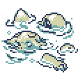

| Trainer | Team | Where |
|---|---|---|
| CORPSE | [ANIFISH](pokedex/223_ANIFISH.md) Lv32, [SCROTRA](pokedex/117_SCROTRA.md) Lv30 | Area 19 |
| REMAINS | [HENTAICOOL](pokedex/072_HENTAICOOL.md) Lv20, [HENTAICOOL](pokedex/072_HENTAICOOL.md) Lv20 | Area 40 |
| REMAINS | [SHELLDER](pokedex/090_SHELLDER.md) Lv18, [SCOLANO](pokedex/008_SCOLANO.md) Lv20, [SHELLDER](pokedex/090_SHELLDER.md) Lv18 | Area 40 |
| REMAINS | [SHELLDER](pokedex/090_SHELLDER.md) Lv21, [HENTAICOOL](pokedex/072_HENTAICOOL.md) Lv19, [HENTAIGORE](pokedex/073_HENTAIGORE.md) Lv19 | Area 41 |
| REMAINS | [HENTAICOOL](pokedex/072_HENTAICOOL.md) Lv16, [HENTAICOOL](pokedex/072_HENTAICOOL.md) Lv17, [HENTAICOOL](pokedex/072_HENTAICOOL.md) Lv16, [MALOKINGI](pokedex/120_MALOKINGI.md) Lv19, [HENTAICOOL](pokedex/072_HENTAICOOL.md) Lv17, [ANIFISH](pokedex/223_ANIFISH.md) Lv19 | Area 41 |
| CORPSE | [NAVALMINO](pokedex/211_NAVALMINO.md) Lv23 | Area 41 |
| CORPSE | [HANNYADOS](pokedex/130_HANNYADOS.md) Lv20, [HANNYADOS](pokedex/130_HANNYADOS.md) Lv20 | Area 41 |
| CORPSE | [TOXIWASTE](pokedex/098_TOXIWASTE.md) Lv23 | Area 41 |
| CORPSE | [MEGADIL](pokedex/086_MEGADIL.md) Lv24, [MEGADIL500](pokedex/087_MEGADIL500.md) Lv25, [MEGADIL](pokedex/086_MEGADIL.md) Lv24 |  |
| CORPSE | [PILOSWINE](pokedex/221_PILOSWINE.md) Lv26, [PILOSWINE](pokedex/221_PILOSWINE.md) Lv26 |  |
| CORPSE | [SHELLDER](pokedex/090_SHELLDER.md) Lv24, [VAGINDAM](pokedex/091_VAGINDAM.md) Lv25, [SHELLDER](pokedex/090_SHELLDER.md) Lv24 |  |
| REMAINS | [COCKY](pokedex/116_COCKY.md) Lv15, [COCKY](pokedex/116_COCKY.md) Lv15, [SCROTRA](pokedex/117_SCROTRA.md) Lv20 |  |
| REMAINS | [MALOKINGI](pokedex/120_MALOKINGI.md) Lv13, [IRUKUNJI](pokedex/121_IRUKUNJI.md) Lv18, [COCKY](pokedex/116_COCKY.md) Lv16 |  |
| CORPSE | [SCROTRA](pokedex/117_SCROTRA.md) Lv26, [HENTAICOOL](pokedex/072_HENTAICOOL.md) Lv28, [HENTAIGORE](pokedex/073_HENTAIGORE.md) Lv30, [BLINKY](pokedex/118_BLINKY.md) Lv28 | Area 19 |
| CORPSE | [SHELLDER](pokedex/090_SHELLDER.md) Lv30, [VAGINDAM](pokedex/091_VAGINDAM.md) Lv34 | Area 19 |
| REMAINS | [MALOKINGI](pokedex/120_MALOKINGI.md) Lv13, [IRUKUNJI](pokedex/121_IRUKUNJI.md) Lv18, [COCKY](pokedex/116_COCKY.md) Lv16 |  |
| CORPSE | [HALUAL](pokedex/183_HALUAL.md) Lv34 | Area 20 |
| CORPSE | [ASPHYXIAR](pokedex/195_ASPHYXIAR.md) Lv29, [TOSHIOKI](pokedex/224_TOSHIOKI.md) Lv29, [ASPHYXIAR](pokedex/195_ASPHYXIAR.md) Lv32 | Area 21 |
| REMAINS | [MALOKINGI](pokedex/120_MALOKINGI.md) Lv13, [IRUKUNJI](pokedex/121_IRUKUNJI.md) Lv18, [COCKY](pokedex/116_COCKY.md) Lv16 |  |
| REMAINS | [MALOKINGI](pokedex/120_MALOKINGI.md) Lv13, [IRUKUNJI](pokedex/121_IRUKUNJI.md) Lv18, [COCKY](pokedex/116_COCKY.md) Lv16 |  |
| CORPSE | [COCKY](pokedex/116_COCKY.md) Lv32, [COCKY](pokedex/116_COCKY.md) Lv32, [SCROTRA](pokedex/117_SCROTRA.md) Lv35 | Cerulean City Gym |

## SWIMMER♀

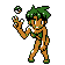

| Trainer | Team | Where |
|---|---|---|
| ELAINE | [MALOKINGI](pokedex/120_MALOKINGI.md) Lv21 | Area 40 |
| PAULA | [MALOKINGI](pokedex/120_MALOKINGI.md) Lv19, [SHELLDER](pokedex/090_SHELLDER.md) Lv19 | Area 40 |
| KAYLEE | [BLINKY](pokedex/118_BLINKY.md) Lv18, [BLINKY](pokedex/118_BLINKY.md) Lv20, [HOGEROT](pokedex/119_HOGEROT.md) Lv20 | Area 41 |
| SUSIE | [WORMACK](pokedex/054_WORMACK.md) Lv20, [BLINKY](pokedex/118_BLINKY.md) Lv22 | Area 41 |
| DENISE | [MEGADIL](pokedex/086_MEGADIL.md) Lv22 | Area 41 |
| KARA | [MALOKINGI](pokedex/120_MALOKINGI.md) Lv20, [IRUKUNJI](pokedex/121_IRUKUNJI.md) Lv20 | Area 41 |
| WENDY | [COCKY](pokedex/116_COCKY.md) Lv21, [COCKY](pokedex/116_COCKY.md) Lv21 | Area 41 |
| LISA | [JYZZO](pokedex/124_JYZZO.md) Lv28 |  |
| JILL | [MEGADIL500](pokedex/087_MEGADIL500.md) Lv28 |  |
| MARY | [HOGEROT](pokedex/119_HOGEROT.md) Lv20 |  |
| KATIE | [MEGADIL500](pokedex/087_MEGADIL500.md) Lv33 |  |
| DAWN | [HOGEROT](pokedex/119_HOGEROT.md) Lv34 | Area 19 |
| TARA | [HOGEROT](pokedex/119_HOGEROT.md) Lv20 |  |
| NICOLE | [HALUAL](pokedex/183_HALUAL.md) Lv29, [HALUAL](pokedex/183_HALUAL.md) Lv29, [KARONTIS](pokedex/131_KARONTIS.md) Lv32 | Area 20 |
| LORI | [IRUKUNJI](pokedex/121_IRUKUNJI.md) Lv32, [IRUKUNJI](pokedex/121_IRUKUNJI.md) Lv32 | Area 20 |
| JODY | [HOGEROT](pokedex/119_HOGEROT.md) Lv20 |  |
| NIKKI | [MEGADIL](pokedex/086_MEGADIL.md) Lv28, [MEGADIL](pokedex/086_MEGADIL.md) Lv28, [MEGADIL](pokedex/086_MEGADIL.md) Lv28, [MEGADIL500](pokedex/087_MEGADIL500.md) Lv28 | Area 21 |
| DIANA | [DUKAKIS](pokedex/055_DUKAKIS.md) Lv37 | Cerulean City Gym |
| BRIANA | [HOGEROT](pokedex/119_HOGEROT.md) Lv35, [HOGEROT](pokedex/119_HOGEROT.md) Lv35 | Cerulean City Gym |

## PRISONER

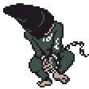

| Trainer | Team | Where |
|---|---|---|
| EUGENE | [PROLIFIK](pokedex/061_PROLIFIK.md) Lv17, [RATOZZO](pokedex/020_RATOZZO.md) Lv17, [TOXIWASTE](pokedex/098_TOXIWASTE.md) Lv19 | Area 39 |
| HUEY | [SPERMOTZ](pokedex/060_SPERMOTZ.md) Lv18, [PROLIFIK](pokedex/061_PROLIFIK.md) Lv18 | Pentafloor 2F |
| TERRELL | [PROLIFIK](pokedex/061_PROLIFIK.md) Lv20 | Pentafloor 3F |
| KENT | [TOXIWASTE](pokedex/098_TOXIWASTE.md) Lv18, [TOXIWASTE](pokedex/098_TOXIWASTE.md) Lv20 | Pentafloor 4F |
| ERNEST | [ANOREX](pokedex/066_ANOREX.md) Lv18, [ANOREX](pokedex/066_ANOREX.md) Lv18, [PROLIFIK](pokedex/061_PROLIFIK.md) Lv18 | Pentafloor 5F |
| JEFF | [RATOZZO](pokedex/020_RATOZZO.md) Lv32, [RATOZZO](pokedex/020_RATOZZO.md) Lv32 | Fast Ship B1F |
| GARRETT | [NUKEBARL](pokedex/099_NUKEBARL.md) Lv34 | Fast Ship B1F |
| KENNETH | [ANOREX](pokedex/066_ANOREX.md) Lv28, [ANOREX](pokedex/066_ANOREX.md) Lv28, [SMEGMATIC](pokedex/062_SMEGMATIC.md) Lv28, [ANOREX](pokedex/066_ANOREX.md) Lv28 | Fast Ship B1F |
| STANLY | [ANOREX](pokedex/066_ANOREX.md) Lv31, [STERODO](pokedex/067_STERODO.md) Lv33, [WORMACK](pokedex/054_WORMACK.md) Lv26 | Fast Ship |
| HARRY | [KOTZWAR](pokedex/194_KOTZWAR.md) Lv19 | Area 38 |
| HUEY | [PROLIFIK](pokedex/061_PROLIFIK.md) Lv28, [PROLIFIK](pokedex/061_PROLIFIK.md) Lv28 | Pentafloor 2F |
| HUEY | [PROLIFIK](pokedex/061_PROLIFIK.md) Lv34, [SMEGMATIC](pokedex/062_SMEGMATIC.md) Lv34 | Pentafloor 2F |
| HUEY | [FETUSO](pokedex/186_FETUSO.md) Lv38, [SMEGMATIC](pokedex/062_SMEGMATIC.md) Lv38 | Pentafloor 2F |

## OBSCURE

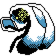

| Trainer | Team | Where |
|---|---|---|
| PROGRAMMER | [GRINDED](pokedex/088_GRINDED.md) Lv20 |  |
| PROGRAMMER | [GRINDED](pokedex/088_GRINDED.md) Lv11, [GRINDED](pokedex/088_GRINDED.md) Lv11 | Metro Complex |
| GREGG | [GHOSHELLO](pokedex/081_GHOSHELLO.md) Lv20, [GHOSHELLO](pokedex/081_GHOSHELLO.md) Lv20, [GHOSHELLO](pokedex/081_GHOSHELLO.md) Lv20 |  |
| JAY | [SARSARAS](pokedex/109_SARSARAS.md) Lv22, [SARSARAS](pokedex/109_SARSARAS.md) Lv22 |  |
| DAVE | [SHITTO](pokedex/132_SHITTO.md) Lv24 |  |
| SAM | [GRINDED](pokedex/088_GRINDED.md) Lv34, [KUMORAH](pokedex/089_KUMORAH.md) Lv34 | Area 8 |
| TOM | [GHOSHELLO](pokedex/081_GHOSHELLO.md) Lv32, [GHOSHELLO](pokedex/081_GHOSHELLO.md) Lv32, [GHOSHELLO](pokedex/081_GHOSHELLO.md) Lv32 | Area 8 |
| PAT | [TERMINALIX](pokedex/137_TERMINALIX.md) Lv36 | Area 25 |
| SHAWN | [GHOSHELLO](pokedex/081_GHOSHELLO.md) Lv31, [KUMORAH](pokedex/089_KUMORAH.md) Lv33, [GHOSHELLO](pokedex/081_GHOSHELLO.md) Lv31 | Fast Ship |
| TERU | [GHOSHELLO](pokedex/081_GHOSHELLO.md) Lv7, [KOWARENING](pokedex/100_KOWARENING.md) Lv11, [GHOSHELLO](pokedex/081_GHOSHELLO.md) Lv7, [GHOSHELLO](pokedex/081_GHOSHELLO.md) Lv9 | Metro Complex |
| RUSS | [GHOSHELLO](pokedex/081_GHOSHELLO.md) Lv27, [GHOSHELLO](pokedex/081_GHOSHELLO.md) Lv27, [GHOSHELLO](pokedex/081_GHOSHELLO.md) Lv27 |  |
| NORTON | [TERMINALIX](pokedex/137_TERMINALIX.md) Lv30 |  |
| HUGH | [SCROTRA](pokedex/117_SCROTRA.md) Lv39 | Mt.Mortar 2F |
| MARKUS | [SLOWGHOST](pokedex/079_SLOWGHOST.md) Lv19 | Mt.Mortar 1F |

## RIVAL

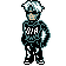

| Trainer | Team | Where |
|---|---|---|
| NOIAAGENT | [KUNOIGA](pokedex/215_KUNOIGA.md) Lv41, [VAMPESSA](pokedex/042_VAMPESSA.md) Lv42, [SORAYAMBOT](pokedex/082_SORAYAMBOT.md) Lv41, [TREROR](pokedex/094_TREROR.md) Lv43, [MARTIRUS](pokedex/065_MARTIRUS.md) Lv43, [AYAHUASCO](pokedex/154_AYAHUASCO.md) Lv45 | Mt.Moon |
| NOIAAGENT | [KUNOIGA](pokedex/215_KUNOIGA.md) Lv41, [VAMPESSA](pokedex/042_VAMPESSA.md) Lv42, [SORAYAMBOT](pokedex/082_SORAYAMBOT.md) Lv41, [TREROR](pokedex/094_TREROR.md) Lv43, [MARTIRUS](pokedex/065_MARTIRUS.md) Lv43, [INFERNATUS](pokedex/157_INFERNATUS.md) Lv45 | Mt.Moon |
| NOIAAGENT | [KUNOIGA](pokedex/215_KUNOIGA.md) Lv41, [VAMPESSA](pokedex/042_VAMPESSA.md) Lv42, [SORAYAMBOT](pokedex/082_SORAYAMBOT.md) Lv41, [TREROR](pokedex/094_TREROR.md) Lv43, [MARTIRUS](pokedex/065_MARTIRUS.md) Lv43, [CROCOSNUFF](pokedex/160_CROCOSNUFF.md) Lv45 | Mt.Moon |
| NOIAAGENT | [KUNOIGA](pokedex/215_KUNOIGA.md) Lv45, [TRIZOM](pokedex/169_TRIZOM.md) Lv48, [SORAYAMBOT](pokedex/082_SORAYAMBOT.md) Lv45, [TREROR](pokedex/094_TREROR.md) Lv46, [MARTIRUS](pokedex/065_MARTIRUS.md) Lv46, [AYAHUASCO](pokedex/154_AYAHUASCO.md) Lv50 | Indigo Plateau 1F |
| NOIAAGENT | [KUNOIGA](pokedex/215_KUNOIGA.md) Lv45, [TRIZOM](pokedex/169_TRIZOM.md) Lv48, [SORAYAMBOT](pokedex/082_SORAYAMBOT.md) Lv45, [TREROR](pokedex/094_TREROR.md) Lv46, [MARTIRUS](pokedex/065_MARTIRUS.md) Lv46, [INFERNATUS](pokedex/157_INFERNATUS.md) Lv50 | Indigo Plateau 1F |
| NOIAAGENT | [KUNOIGA](pokedex/215_KUNOIGA.md) Lv45, [TRIZOM](pokedex/169_TRIZOM.md) Lv48, [SORAYAMBOT](pokedex/082_SORAYAMBOT.md) Lv45, [TREROR](pokedex/094_TREROR.md) Lv46, [MARTIRUS](pokedex/065_MARTIRUS.md) Lv46, [CROCOSNUFF](pokedex/160_CROCOSNUFF.md) Lv50 | Indigo Plateau 1F |

## GUITARIST

| Trainer | Team | Where |
|---|---|---|
| CLYDE | [VOLCUTION](pokedex/125_VOLCUTION.md) Lv34 | Fast Ship |
| VINCENT | [GHOSHELLO](pokedex/081_GHOSHELLO.md) Lv27, [KOWARENING](pokedex/100_KOWARENING.md) Lv33, [GHOSHELLO](pokedex/081_GHOSHELLO.md) Lv32, [GHOSHELLO](pokedex/081_GHOSHELLO.md) Lv32 | Vermilion City Gym |

## PEST CONTROL

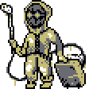

| Trainer | Team | Where |
|---|---|---|
| ANTHONY | [URANIUM](pokedex/074_URANIUM.md) Lv16, [KONGORISH](pokedex/068_KONGORISH.md) Lv18 | Area 33 |
| RUSSELL | [URANIUM](pokedex/074_URANIUM.md) Lv4, [URANIUM](pokedex/074_URANIUM.md) Lv6, [URANIUM](pokedex/074_URANIUM.md) Lv8 | Union Cave 1F |
| PHILLIP | [URANIUM](pokedex/074_URANIUM.md) Lv23, [URANIUM](pokedex/074_URANIUM.md) Lv23, [PLUTONIUM](pokedex/075_PLUTONIUM.md) Lv23 | Union Cave B1F |
| LEONARD | [URANIUM](pokedex/074_URANIUM.md) Lv23, [ANOREX](pokedex/066_ANOREX.md) Lv25 | Union Cave B1F |
| ANTHONY | [URANIUM](pokedex/074_URANIUM.md) Lv11, [ANOREX](pokedex/066_ANOREX.md) Lv11 | Area 33 |
| BENJAMIN | [KAZETTO](pokedex/050_KAZETTO.md) Lv14, [URANIUM](pokedex/074_URANIUM.md) Lv14, [GANGBANGO](pokedex/051_GANGBANGO.md) Lv16 | Area 42 |
| ERIK | [ANOREX](pokedex/066_ANOREX.md) Lv24, [PLUTONIUM](pokedex/075_PLUTONIUM.md) Lv27, [ANOREX](pokedex/066_ANOREX.md) Lv27 | Area 45 |
| MICHAEL | [URANIUM](pokedex/074_URANIUM.md) Lv25, [PLUTONIUM](pokedex/075_PLUTONIUM.md) Lv25, [ATOMIUM](pokedex/076_ATOMIUM.md) Lv25 | Area 45 |
| PARRY | [OBSIDIAN](pokedex/095_OBSIDIAN.md) Lv35, [SWINUB](pokedex/220_SWINUB.md) Lv33 | Area 45 |
| TIMOTHY | [KAZETTO](pokedex/050_KAZETTO.md) Lv27, [GANGBANGO](pokedex/051_GANGBANGO.md) Lv27 | Area 45 |
| BAILEY | [URANIUM](pokedex/074_URANIUM.md) Lv13, [URANIUM](pokedex/074_URANIUM.md) Lv13, [URANIUM](pokedex/074_URANIUM.md) Lv13, [URANIUM](pokedex/074_URANIUM.md) Lv13, [URANIUM](pokedex/074_URANIUM.md) Lv13 | Area 46 |
| ANTHONY | [PLUTONIUM](pokedex/075_PLUTONIUM.md) Lv25, [PLUTONIUM](pokedex/075_PLUTONIUM.md) Lv27, [STERODO](pokedex/067_STERODO.md) Lv29 | Area 33 |
| TIM | [PLUTONIUM](pokedex/075_PLUTONIUM.md) Lv31, [PLUTONIUM](pokedex/075_PLUTONIUM.md) Lv31, [PLUTONIUM](pokedex/075_PLUTONIUM.md) Lv31 | Area 9 |
| NOLAND | [SPHINXO](pokedex/028_SPHINXO.md) Lv31, [ATOMIUM](pokedex/076_ATOMIUM.md) Lv33 | Fast Ship |
| SIDNEY | [GANGBANGO](pokedex/051_GANGBANGO.md) Lv34, [OBSIDIAN](pokedex/095_OBSIDIAN.md) Lv32 | Area 9 |
| KENNY | [SPHINXO](pokedex/028_SPHINXO.md) Lv27, [PLUTONIUM](pokedex/075_PLUTONIUM.md) Lv29, [ATOMIUM](pokedex/076_ATOMIUM.md) Lv31, [PLUTONIUM](pokedex/075_PLUTONIUM.md) Lv29 | Area 13 |
| JIM | [KONGORISH](pokedex/068_KONGORISH.md) Lv35 | Area 10 |
| RATS | [OBSIDIAN](pokedex/095_OBSIDIAN.md) Lv11 | Union Cave 1F |
| RATS | [PILOSWINE](pokedex/221_PILOSWINE.md) Lv35, [GANGBANGO](pokedex/051_GANGBANGO.md) Lv35, [HYDRAGYRUM](pokedex/208_HYDRAGYRUM.md) Lv38 | Area 45 |
| ROACH | [OBSIDIAN](pokedex/095_OBSIDIAN.md) Lv29 | Area 45 |
| ROACH | [PLUTONIUM](pokedex/075_PLUTONIUM.md) Lv30, [PLUTONIUM](pokedex/075_PLUTONIUM.md) Lv30, [STERODO](pokedex/067_STERODO.md) Lv32 | Area 33 |
| ANTHONY | [PLUTONIUM](pokedex/075_PLUTONIUM.md) Lv34, [ATOMIUM](pokedex/076_ATOMIUM.md) Lv36, [STERODO](pokedex/067_STERODO.md) Lv34 | Area 33 |

## BIKER

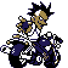

| Trainer | Team | Where |
|---|---|---|
| BENNY | [SARSARAS](pokedex/109_SARSARAS.md) Lv20, [SARSARAS](pokedex/109_SARSARAS.md) Lv20, [SARSARAS](pokedex/109_SARSARAS.md) Lv20 |  |
| KAZU | [SARSARAS](pokedex/109_SARSARAS.md) Lv20, [SARSARAS](pokedex/109_SARSARAS.md) Lv20, [SARSARAS](pokedex/109_SARSARAS.md) Lv20 |  |
| DWAYNE | [SARSARAS](pokedex/109_SARSARAS.md) Lv27, [SARSARAS](pokedex/109_SARSARAS.md) Lv28, [SARSARAS](pokedex/109_SARSARAS.md) Lv29, [SARSARAS](pokedex/109_SARSARAS.md) Lv30 | Area 8 |
| HARRIS | [CERBERION](pokedex/136_CERBERION.md) Lv34 | Area 8 |
| ZEKE | [SARSARAS](pokedex/109_SARSARAS.md) Lv32, [SARSARAS](pokedex/109_SARSARAS.md) Lv32 | Area 8 |
| CHARLES | [SARSARAS](pokedex/109_SARSARAS.md) Lv30, [BELIALEON](pokedex/005_BELIALEON.md) Lv30, [LUNGANSER](pokedex/110_LUNGANSER.md) Lv30 | Area 17 |
| RILEY | [LUNGANSER](pokedex/110_LUNGANSER.md) Lv34 | Area 17 |
| JOEL | [BURNAR](pokedex/126_BURNAR.md) Lv32, [BURNAR](pokedex/126_BURNAR.md) Lv32 | Area 17 |
| GLENN | [SARSARAS](pokedex/109_SARSARAS.md) Lv28, [BURNAR](pokedex/126_BURNAR.md) Lv30, [LUNGANSER](pokedex/110_LUNGANSER.md) Lv32 | Area 17 |

## LEADER (BLAINE)

| Trainer | Team | Where |
|---|---|---|
| BLAINE | [MAGCARGO](pokedex/219_MAGCARGO.md) Lv45, [BURNAR](pokedex/126_BURNAR.md) Lv45, [FAXHIRO](pokedex/078_FAXHIRO.md) Lv50 | Seafoam Islands Gym |

## JUGGALO

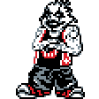

| Trainer | Team | Where |
|---|---|---|
| DUNCAN | [SARSARAS](pokedex/109_SARSARAS.md) Lv23, [BURNAR](pokedex/126_BURNAR.md) Lv25, [SARSARAS](pokedex/109_SARSARAS.md) Lv23 | Metro Complex |
| EDDIE | [SCRATCHY](pokedex/058_SCRATCHY.md) Lv26, [SARSARAS](pokedex/109_SARSARAS.md) Lv24 | Metro Complex, Oversea Asylum Gym |
| COREY | [SARSARAS](pokedex/109_SARSARAS.md) Lv25, [BURNAR](pokedex/126_BURNAR.md) Lv28, [SARSARAS](pokedex/109_SARSARAS.md) Lv25, [SARSARAS](pokedex/109_SARSARAS.md) Lv30 | Fast Ship |

## PUNKABBESTIA

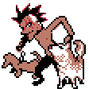

| Trainer | Team | Where |
|---|---|---|
| OTIS | [BURNAR](pokedex/126_BURNAR.md) Lv29, [LUNGANSER](pokedex/110_LUNGANSER.md) Lv32, [BURNAR](pokedex/126_BURNAR.md) Lv29 | Area 3 |
| DICK | [BELIALEON](pokedex/005_BELIALEON.md) Lv17 |  |
| NED | [SARSARAS](pokedex/109_SARSARAS.md) Lv15, [SCRATCHY](pokedex/058_SCRATCHY.md) Lv16, [SARSARAS](pokedex/109_SARSARAS.md) Lv15 |  |
| BURT | [SARSARAS](pokedex/109_SARSARAS.md) Lv32, [MELTEFAS](pokedex/218_MELTEFAS.md) Lv32 | Area 3 |
| BILL | [SARSARAS](pokedex/109_SARSARAS.md) Lv6, [SARSARAS](pokedex/109_SARSARAS.md) Lv6 | Union Cave 1F |
| WALT | [BURNAR](pokedex/126_BURNAR.md) Lv11, [BURNAR](pokedex/126_BURNAR.md) Lv13 | Area 35 |
| RAY | [NYMPHAX](pokedex/037_NYMPHAX.md) Lv9 | Union Cave 1F |
| LYLE | [SARSARAS](pokedex/109_SARSARAS.md) Lv28, [CERBERION](pokedex/136_CERBERION.md) Lv31, [SARSARAS](pokedex/109_SARSARAS.md) Lv28 | Fast Ship |

## STUPID HIPPY

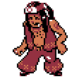

| Trainer | Team | Where |
|---|---|---|
| IRWIN | [KOWARENING](pokedex/100_KOWARENING.md) Lv2, [KOWARENING](pokedex/100_KOWARENING.md) Lv6, [KOWARENING](pokedex/100_KOWARENING.md) Lv10, [KOWARENING](pokedex/100_KOWARENING.md) Lv14 | Area 35 |
| FRITZ | [MR.SHADOW](pokedex/122_MR_SHADOW.md) Lv29, [BURNAR](pokedex/126_BURNAR.md) Lv29, [STERODO](pokedex/067_STERODO.md) Lv29 | Fast Ship B1F |
| HORTON | [NINGOGORE](pokedex/101_NINGOGORE.md) Lv33, [NINGOGORE](pokedex/101_NINGOGORE.md) Lv33, [NINGOGORE](pokedex/101_NINGOGORE.md) Lv33, [NINGOGORE](pokedex/101_NINGOGORE.md) Lv33 | Vermilion City Gym |
| IRWIN | [KOWARENING](pokedex/100_KOWARENING.md) Lv6, [KOWARENING](pokedex/100_KOWARENING.md) Lv10, [KOWARENING](pokedex/100_KOWARENING.md) Lv14, [KOWARENING](pokedex/100_KOWARENING.md) Lv18 |  |
| IRWIN | [KOWARENING](pokedex/100_KOWARENING.md) Lv18, [KOWARENING](pokedex/100_KOWARENING.md) Lv22, [KOWARENING](pokedex/100_KOWARENING.md) Lv26, [NINGOGORE](pokedex/101_NINGOGORE.md) Lv30 |  |
| IRWIN | [KOWARENING](pokedex/100_KOWARENING.md) Lv18, [KOWARENING](pokedex/100_KOWARENING.md) Lv22, [KOWARENING](pokedex/100_KOWARENING.md) Lv26, [NINGOGORE](pokedex/101_NINGOGORE.md) Lv30 |  |

## YAKUZA

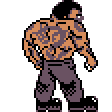

| Trainer | Team | Where |
|---|---|---|
| KENJI | [OBSIDIAN](pokedex/095_OBSIDIAN.md) Lv27, [THAIFAITA](pokedex/106_THAIFAITA.md) Lv30, [OBSIDIAN](pokedex/095_OBSIDIAN.md) Lv27, [STERODO](pokedex/067_STERODO.md) Lv32 |  |
| YOSHI | [THAIFAITA](pokedex/106_THAIFAITA.md) Lv27 |  |
| KENJI | [OBSIDIAN](pokedex/095_OBSIDIAN.md) Lv33, [KONGORISH](pokedex/068_KONGORISH.md) Lv38, [HYDRAGYRUM](pokedex/208_HYDRAGYRUM.md) Lv33, [THAIFAITA](pokedex/106_THAIFAITA.md) Lv36 |  |
| LAO | [MIKEFAITA](pokedex/107_MIKEFAITA.md) Lv27 |  |
| NOB | [ANOREX](pokedex/066_ANOREX.md) Lv25, [STERODO](pokedex/067_STERODO.md) Lv25 |  |
| KIYO | [THAIFAITA](pokedex/106_THAIFAITA.md) Lv34, [MIKEFAITA](pokedex/107_MIKEFAITA.md) Lv34 | Mt.Mortar B1F |
| LUNG | [HIROOSH](pokedex/056_HIROOSH.md) Lv23, [HIROOSH](pokedex/056_HIROOSH.md) Lv23, [NAGASAK](pokedex/057_NAGASAK.md) Lv25 |  |
| KENJI | [STERODO](pokedex/067_STERODO.md) Lv28 | Area 45 |
| WAI | [STERODO](pokedex/067_STERODO.md) Lv30, [STERODO](pokedex/067_STERODO.md) Lv32, [STERODO](pokedex/067_STERODO.md) Lv34 | Fast Ship B1F |

## ROCKET (EXECUTIVE)

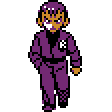

| Trainer | Team | Where |
|---|---|---|
| EXECUTIVE | [HOUNDOUR](pokedex/228_HOUNDOUR.md) Lv33, [SARSARAS](pokedex/109_SARSARAS.md) Lv33, [HOUNDOOM](pokedex/229_HOUNDOOM.md) Lv35 | Radio Tower 5F |
| EXECUTIVE | [VAMPESSA](pokedex/042_VAMPESSA.md) Lv36 | Radio Tower 4F |
| EXECUTIVE | [SARSARAS](pokedex/109_SARSARAS.md) Lv30, [SARSARAS](pokedex/109_SARSARAS.md) Lv30, [SARSARAS](pokedex/109_SARSARAS.md) Lv30, [LUNGANSER](pokedex/110_LUNGANSER.md) Lv32, [SARSARAS](pokedex/109_SARSARAS.md) Lv30, [SARSARAS](pokedex/109_SARSARAS.md) Lv30 | Radio Tower 5F |
| EXECUTIVE | [GOTCHICK](pokedex/041_GOTCHICK.md) Lv22, [RATOZZO](pokedex/020_RATOZZO.md) Lv24, [SARSARAS](pokedex/109_SARSARAS.md) Lv22 | Lonely Woods B3F |

## CONSPIRACY

| Trainer | Team | Where |
|---|---|---|
| THEORIST | [ENIGMAGUS](pokedex/203_ENIGMAGUS.md) Lv26 | Bio Impact |
| THEORIST | [PROFETUS](pokedex/064_PROFETUS.md) Lv37 | Saffron City Gym |
| THEORIST | [DARUMORT](pokedex/102_DARUMORT.md) Lv30, [DARUMORT](pokedex/102_DARUMORT.md) Lv30, [MASKABUKI](pokedex/103_MASKABUKI.md) Lv30 | Area 11 |
| THEORIST | [QUELZALCOT](pokedex/178_QUELZALCOT.md) Lv34 | Area 11 |
| THEORIST | [DUPUPETT](pokedex/096_DUPUPETT.md) Lv17 | Area 37 |
| THEORIST | [SLOWGHOST](pokedex/079_SLOWGHOST.md) Lv17, [SLOWGHOST](pokedex/079_SLOWGHOST.md) Lv20 | Area 39 |
| THEORIST | [GENESUS](pokedex/063_GENESUS.md) Lv13, [GENESUS](pokedex/063_GENESUS.md) Lv13, [PROFETUS](pokedex/064_PROFETUS.md) Lv15 | Area 36 |
| THEORIST | [SACRILUT](pokedex/177_SACRILUT.md) Lv24, [PROFETUS](pokedex/064_PROFETUS.md) Lv26 | Area 44 |
| THEORIST | [EMBRYEON](pokedex/196_EMBRYEON.md) Lv36 | Area 26 |
| THEORIST | [IRUKUNJI](pokedex/121_IRUKUNJI.md) Lv30, [DARUMORT](pokedex/102_DARUMORT.md) Lv30, [ENIGMAGUS](pokedex/203_ENIGMAGUS.md) Lv34 | Area 27 |
| THEORIST | [MR.SHADOW](pokedex/122_MR_SHADOW.md) Lv32, [DARUMORT](pokedex/102_DARUMORT.md) Lv32, [DARUMORT](pokedex/102_DARUMORT.md) Lv35 | Saffron City Gym |
| THEORIST | [DUPUPETT](pokedex/096_DUPUPETT.md) Lv29, [BURHAT](pokedex/097_BURHAT.md) Lv33 | Fast Ship |

## CAR STRUCK

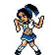

| Trainer | Team | Where |
|---|---|---|
| LIZ | [FINGAH](pokedex/029_FINGAH.md) Lv9 | Area 32 |
| GINA | [ABORTITO](pokedex/187_ABORTITO.md) Lv9, [ABORTITO](pokedex/187_ABORTITO.md) Lv9, [WEEDAZOR](pokedex/001_WEEDAZOR.md) Lv12 | Area 34 |
| BROOKE | [PIKACHEWED](pokedex/025_PIKACHEWED.md) Lv16 | Area 35 |
| KIM | [NYMPHAX](pokedex/037_NYMPHAX.md) Lv15 | Area 35 |
| CINDY | [KALEDENDS](pokedex/031_KALEDENDS.md) Lv36 | Fuchsia City Gym |
| HOPE | [ALGOCRAT](pokedex/180_ALGOCRAT.md) Lv34 | Area 4 |
| SHARON | [JIHADO](pokedex/162_JIHADO.md) Lv31, [FAXHIRO](pokedex/078_FAXHIRO.md) Lv33 | Area 4 |
| DEBRA | [HOGEROT](pokedex/119_HOGEROT.md) Lv33 | Fast Ship B1F |
| GINA | [ABORTITO](pokedex/187_ABORTITO.md) Lv14, [ABORTITO](pokedex/187_ABORTITO.md) Lv14, [COCAZOR](pokedex/002_COCAZOR.md) Lv17 | Area 34 |
| ERIN | [HELLESTO](pokedex/077_HELLESTO.md) Lv16, [HELLESTO](pokedex/077_HELLESTO.md) Lv16 | Area 46 |
| LIZ | [GUILTYOTIN](pokedex/070_GUILTYOTIN.md) Lv15, [HANDA](pokedex/030_HANDA.md) Lv15 | Area 32 |
| LIZ | [GUILTYOTIN](pokedex/070_GUILTYOTIN.md) Lv19, [GRABOIDO](pokedex/033_GRABOIDO.md) Lv19, [KALEDENDS](pokedex/031_KALEDENDS.md) Lv21 | Area 32 |
| HEIDI | [INCUBATO](pokedex/188_INCUBATO.md) Lv32, [INCUBATO](pokedex/188_INCUBATO.md) Lv32 | Area 9 |
| EDNA | [HANDA](pokedex/030_HANDA.md) Lv30, [RAICHEWEDZ](pokedex/026_RAICHEWEDZ.md) Lv34 | Area 9 |
| GINA | [INCUBATO](pokedex/188_INCUBATO.md) Lv26, [INCUBATO](pokedex/188_INCUBATO.md) Lv26, [COCAZOR](pokedex/002_COCAZOR.md) Lv29 | Area 34 |
| TIFFANY | [CRISTALIA](pokedex/035_CRISTALIA.md) Lv31 | Area 43 |
| TIFFANY | [CRISTALIA](pokedex/035_CRISTALIA.md) Lv37 | Area 43 |
| ERIN | [HELLESTO](pokedex/077_HELLESTO.md) Lv32, [HELLESTO](pokedex/077_HELLESTO.md) Lv32 | Area 46 |
| TANYA | [MASKABUKI](pokedex/103_MASKABUKI.md) Lv37 | Celadon City Gym |
| TIFFANY | [CRISTALIA](pokedex/035_CRISTALIA.md) Lv20 | Area 43 |
| ERIN | [HELLESTO](pokedex/077_HELLESTO.md) Lv36, [RAICHEWEDZ](pokedex/026_RAICHEWEDZ.md) Lv34, [HELLESTO](pokedex/077_HELLESTO.md) Lv36 | Area 46 |
| LIZ | [GUILTYOTIN](pokedex/070_GUILTYOTIN.md) Lv24, [GRABOIDO](pokedex/033_GRABOIDO.md) Lv26, [KALEDENDS](pokedex/031_KALEDENDS.md) Lv26 | Area 32 |
| LIZ | [GUILTYOTIN](pokedex/070_GUILTYOTIN.md) Lv30, [KESARUS](pokedex/034_KESARUS.md) Lv32, [KALEDENDS](pokedex/031_KALEDENDS.md) Lv32 | Area 32 |
| GINA | [INCUBATO](pokedex/188_INCUBATO.md) Lv30, [INCUBATO](pokedex/188_INCUBATO.md) Lv30, [COCAZOR](pokedex/002_COCAZOR.md) Lv32 | Area 34 |
| GINA | [ITTIOSO](pokedex/189_ITTIOSO.md) Lv33, [ITTIOSO](pokedex/189_ITTIOSO.md) Lv33, [OPIUMZOR](pokedex/003_OPIUMZOR.md) Lv38 | Area 34 |
| TIFFANY | [CRISTALIA](pokedex/035_CRISTALIA.md) Lv43 | Area 43 |

## ROMANI GIPSY

| Trainer | Team | Where |
|---|---|---|
| ROLAND | [SCRAMBLO](pokedex/032_SCRAMBLO.md) Lv9 | Area 32 |
| TODD | [WORMACK](pokedex/054_WORMACK.md) Lv14 | Area 34 |
| IVAN | [KAZETTO](pokedex/050_KAZETTO.md) Lv10, [GOTCHICK](pokedex/041_GOTCHICK.md) Lv10, [KAZETTO](pokedex/050_KAZETTO.md) Lv14 | Area 35 |
| ELLIOT | [PAPYRYU](pokedex/027_PAPYRYU.md) Lv13, [HALUAL](pokedex/183_HALUAL.md) Lv15 | Area 35 |
| BARRY | [KESARUS](pokedex/034_KESARUS.md) Lv36 | Fuchsia City Gym |
| LLOYD | [KESARUS](pokedex/034_KESARUS.md) Lv34 | Area 25 |
| DEAN | [DUKAKIS](pokedex/055_DUKAKIS.md) Lv33, [SPHINXO](pokedex/028_SPHINXO.md) Lv31 | Area 9 |
| SID | [GANGBANGO](pokedex/051_GANGBANGO.md) Lv32, [NAGASAK](pokedex/057_NAGASAK.md) Lv29, [SMEGMATIC](pokedex/062_SMEGMATIC.md) Lv29 | Area 9 |
| HARVEY | [GRABOIDO](pokedex/033_GRABOIDO.md) Lv15 |  |
| DALE | [GRABOIDO](pokedex/033_GRABOIDO.md) Lv15 |  |
| TED | [HIROOSH](pokedex/056_HIROOSH.md) Lv17 | Area 46 |
| TODD | [URANIUM](pokedex/074_URANIUM.md) Lv17, [URANIUM](pokedex/074_URANIUM.md) Lv17, [WORMACK](pokedex/054_WORMACK.md) Lv23 | Area 34 |
| TODD | [URANIUM](pokedex/074_URANIUM.md) Lv23, [URANIUM](pokedex/074_URANIUM.md) Lv23, [WORMACK](pokedex/054_WORMACK.md) Lv26 | Area 34 |
| THOMAS | [PLUTONIUM](pokedex/075_PLUTONIUM.md) Lv33, [PLUTONIUM](pokedex/075_PLUTONIUM.md) Lv36, [VAMPESSA](pokedex/042_VAMPESSA.md) Lv40, [DUKAKIS](pokedex/055_DUKAKIS.md) Lv42 |  |
| LEROY | [PLUTONIUM](pokedex/075_PLUTONIUM.md) Lv33, [PLUTONIUM](pokedex/075_PLUTONIUM.md) Lv36, [VAMPESSA](pokedex/042_VAMPESSA.md) Lv40, [DUKAKIS](pokedex/055_DUKAKIS.md) Lv42 |  |
| DAVID | [PLUTONIUM](pokedex/075_PLUTONIUM.md) Lv33, [PLUTONIUM](pokedex/075_PLUTONIUM.md) Lv36, [VAMPESSA](pokedex/042_VAMPESSA.md) Lv40, [DUKAKIS](pokedex/055_DUKAKIS.md) Lv42 |  |
| JOHN | [PLUTONIUM](pokedex/075_PLUTONIUM.md) Lv33, [PLUTONIUM](pokedex/075_PLUTONIUM.md) Lv36, [VAMPESSA](pokedex/042_VAMPESSA.md) Lv40, [DUKAKIS](pokedex/055_DUKAKIS.md) Lv42 |  |
| JERRY | [SPHINXO](pokedex/028_SPHINXO.md) Lv37 | Pewter City Gym |
| SPENCER | [PAPYRYU](pokedex/027_PAPYRYU.md) Lv17, [SPHINXO](pokedex/028_SPHINXO.md) Lv17, [GOTCHICK](pokedex/041_GOTCHICK.md) Lv19 | Area 43 |
| TODD | [PLUTONIUM](pokedex/075_PLUTONIUM.md) Lv30, [PLUTONIUM](pokedex/075_PLUTONIUM.md) Lv30, [MELTEFAS](pokedex/218_MELTEFAS.md) Lv30, [WORMACK](pokedex/054_WORMACK.md) Lv32 | Area 34 |
| TODD | [PLUTONIUM](pokedex/075_PLUTONIUM.md) Lv33, [PLUTONIUM](pokedex/075_PLUTONIUM.md) Lv33, [MAGCARGO](pokedex/219_MAGCARGO.md) Lv36, [DUKAKIS](pokedex/055_DUKAKIS.md) Lv34 | Area 34 |
| QUENTIN | [SGLARFO](pokedex/022_SGLARFO.md) Lv30, [NAGASAK](pokedex/057_NAGASAK.md) Lv30, [DIGESTOR](pokedex/128_DIGESTOR.md) Lv30 | Area 45 |

## ROCKET (EXECUTIVE, Radio Tower 5F)

| Trainer | Team | Where |
|---|---|---|
| EXECUTIVE | [URBOROK](pokedex/024_URBOROK.md) Lv32, [LARSENEF](pokedex/045_LARSENEF.md) Lv32, [SKARKROW](pokedex/198_SKARKROW.md) Lv32 | Radio Tower 5F |
| EXECUTIVE | [URBOROK](pokedex/024_URBOROK.md) Lv23, [INFECTO](pokedex/044_INFECTO.md) Lv23, [SKARKROW](pokedex/198_SKARKROW.md) Lv25 | Lonely Woods B2F |

## SAGE

| Trainer | Team | Where |
|---|---|---|
| CHOW | [PILLORYD](pokedex/069_PILLORYD.md) Lv3, [PILLORYD](pokedex/069_PILLORYD.md) Lv3, [PILLORYD](pokedex/069_PILLORYD.md) Lv3 | Sprout Tower 1F |
| NICO | [PILLORYD](pokedex/069_PILLORYD.md) Lv3, [PILLORYD](pokedex/069_PILLORYD.md) Lv3, [PILLORYD](pokedex/069_PILLORYD.md) Lv3 | Sprout Tower 2F |
| JIN | [PILLORYD](pokedex/069_PILLORYD.md) Lv6 | Sprout Tower 3F |
| TROY | [PILLORYD](pokedex/069_PILLORYD.md) Lv7, [BALAKLOWL](pokedex/163_BALAKLOWL.md) Lv7 | Sprout Tower 3F |
| JEFFREY | [WRAITARL](pokedex/093_WRAITARL.md) Lv22 | Suburbia Gym |
| PING | [GOSBAMP](pokedex/092_GOSBAMP.md) Lv16, [GOSBAMP](pokedex/092_GOSBAMP.md) Lv16, [GOSBAMP](pokedex/092_GOSBAMP.md) Lv16, [GOSBAMP](pokedex/092_GOSBAMP.md) Lv16, [GOSBAMP](pokedex/092_GOSBAMP.md) Lv16 | Suburbia Gym |
| EDMOND | [PILLORYD](pokedex/069_PILLORYD.md) Lv3, [PILLORYD](pokedex/069_PILLORYD.md) Lv3, [PILLORYD](pokedex/069_PILLORYD.md) Lv3 | Sprout Tower 2F |
| NEAL | [PILLORYD](pokedex/069_PILLORYD.md) Lv6 | Sprout Tower 3F |
| LI | [PILLORYD](pokedex/069_PILLORYD.md) Lv7, [PILLORYD](pokedex/069_PILLORYD.md) Lv7, [BALAKLOWL](pokedex/163_BALAKLOWL.md) Lv10 | Sprout Tower 3F |
| GAKU | [ROBBINOWL](pokedex/164_ROBBINOWL.md) Lv32, [CERBERION](pokedex/136_CERBERION.md) Lv32 | Suburbia |
| MASA | [ROBBINOWL](pokedex/164_ROBBINOWL.md) Lv32, [NUKENION](pokedex/135_NUKENION.md) Lv32 | Suburbia |
| KOJI | [ROBBINOWL](pokedex/164_ROBBINOWL.md) Lv32, [VENEREON](pokedex/134_VENEREON.md) Lv32 | Suburbia |

## CULTIST

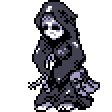

| Trainer | Team | Where |
|---|---|---|
| MARTHA | [GOSBAMP](pokedex/092_GOSBAMP.md) Lv18, [WRAITARL](pokedex/093_WRAITARL.md) Lv20, [GOSBAMP](pokedex/092_GOSBAMP.md) Lv20 | Suburbia Gym |
| GRACE | [WRAITARL](pokedex/093_WRAITARL.md) Lv20, [WRAITARL](pokedex/093_WRAITARL.md) Lv20 | Suburbia Gym |
| BETHANY | [WRAITARL](pokedex/093_WRAITARL.md) Lv25 |  |
| MARGRET | [WRAITARL](pokedex/093_WRAITARL.md) Lv25 |  |
| ETHEL | [WRAITARL](pokedex/093_WRAITARL.md) Lv25 |  |
| REBECCA | [DUPUPETT](pokedex/096_DUPUPETT.md) Lv35, [BURHAT](pokedex/097_BURHAT.md) Lv35 | Saffron City Gym |
| DORIS | [SLOWGHOST](pokedex/079_SLOWGHOST.md) Lv34, [KORNUPIAK](pokedex/080_KORNUPIAK.md) Lv36 | Saffron City Gym |

## BOARDER

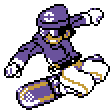

| Trainer | Team | Where |
|---|---|---|
| RONALD | [MEGADIL](pokedex/086_MEGADIL.md) Lv24, [MEGADIL500](pokedex/087_MEGADIL500.md) Lv25, [MEGADIL](pokedex/086_MEGADIL.md) Lv24 | Lonely Woods Gym |
| BRAD | [SWINUB](pokedex/220_SWINUB.md) Lv26, [SWINUB](pokedex/220_SWINUB.md) Lv26 | Lonely Woods Gym |
| DOUGLAS | [SHELLDER](pokedex/090_SHELLDER.md) Lv24, [VAGINDAM](pokedex/091_VAGINDAM.md) Lv25, [SHELLDER](pokedex/090_SHELLDER.md) Lv24 | Lonely Woods Gym |

## PEDOPHILE (WILLIAM, DEREK, …)

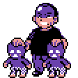

| Trainer | Team | Where |
|---|---|---|
| WILLIAM | [RAICHEWEDZ](pokedex/026_RAICHEWEDZ.md) Lv14 | National Park |
| DEREK | [PIKACHEWED](pokedex/025_PIKACHEWED.md) Lv17 | Area 39 |
| ROBERT | [ASPHYXIAR](pokedex/195_ASPHYXIAR.md) Lv33 | Area 10 |
| JOSHUA | [PIKACHEWED](pokedex/025_PIKACHEWED.md) Lv23, [PIKACHEWED](pokedex/025_PIKACHEWED.md) Lv23, [PIKACHEWED](pokedex/025_PIKACHEWED.md) Lv23, [PIKACHEWED](pokedex/025_PIKACHEWED.md) Lv23, [PIKACHEWED](pokedex/025_PIKACHEWED.md) Lv23, [PIKACHEWED](pokedex/025_PIKACHEWED.md) Lv23 | Area 13 |
| CARTER | [WEEDAZOR](pokedex/001_WEEDAZOR.md) Lv29, [CHARMHELL](pokedex/004_CHARMHELL.md) Lv29, [SCOLINA](pokedex/007_SCOLINA.md) Lv29 | Area 14 |
| TREVOR | [WORMACK](pokedex/054_WORMACK.md) Lv33 | Area 14 |
| BRANDON | [BLEKHOLIA](pokedex/209_BLEKHOLIA.md) Lv13 | Area 34 |
| JEREMY | [NIGGA](pokedex/052_NIGGA.md) Lv28, [NIGGA](pokedex/052_NIGGA.md) Lv28, [NIGGA](pokedex/052_NIGGA.md) Lv28 | Fast Ship |
| COLIN | [ANTENNOIDE](pokedex/225_ANTENNOIDE.md) Lv32 | Fast Ship |
| DEREK | [PIKACHEWED](pokedex/025_PIKACHEWED.md) Lv19 |  |
| DEREK | [PIKACHEWED](pokedex/025_PIKACHEWED.md) Lv36 |  |
| ALEX | [KESARUS](pokedex/034_KESARUS.md) Lv29, [DEPRECLOWN](pokedex/199_DEPRECLOWN.md) Lv29, [HOGEROT](pokedex/119_HOGEROT.md) Lv29 | Area 13 |
| REX | [PHANPY](pokedex/231_PHANPY.md) Lv35 | Area 6 |
| ALLAN | [FLESHPLUSH](pokedex/216_FLESHPLUSH.md) Lv35 | Area 6 |

## SYNTHETIC

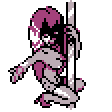

| Trainer | Team | Where |
|---|---|---|
| STRIPPER | [INCUBATO](pokedex/188_INCUBATO.md) Lv20, [NYMPHAX](pokedex/037_NYMPHAX.md) Lv20, [INCUBATO](pokedex/188_INCUBATO.md) Lv18 |  |
| STRIPPER | [CERBERION](pokedex/136_CERBERION.md) Lv17 | Suburbia |
| STRIPPER | [EMBRYEON](pokedex/196_EMBRYEON.md) Lv17 | Suburbia |
| STRIPPER | [DAMNATEON](pokedex/197_DAMNATEON.md) Lv17 | Suburbia |
| STRIPPER | [VENEREON](pokedex/134_VENEREON.md) Lv17 | Suburbia |
| STRIPPER | [NUKENION](pokedex/135_NUKENION.md) Lv17 | Suburbia |

## LESBIAN NUNS

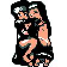

| Trainer | Team | Where |
|---|---|---|
| NASTY | [NAZETTO](pokedex/167_NAZETTO.md) Lv10, [SBIRETTO](pokedex/165_SBIRETTO.md) Lv10 | Los Aura Gym |
| NASTY | [CRISTALIA](pokedex/035_CRISTALIA.md) Lv16, [EYEBALLY](pokedex/039_EYEBALLY.md) Lv16 | Area 37 |
| NASTY | [EYEBALLY](pokedex/039_EYEBALLY.md) Lv16, [CRISTALIA](pokedex/035_CRISTALIA.md) Lv16 | Area 37 |
| NASTY | [SBIRETTO](pokedex/165_SBIRETTO.md) Lv10, [NAZETTO](pokedex/167_NAZETTO.md) Lv10 | Los Aura Gym |
| HORNY | [NORIMBERGU](pokedex/071_NORIMBERGU.md) Lv35, [LARSENEF](pokedex/045_LARSENEF.md) Lv35 | Celadon City Gym |
| HORNY | [LARSENEF](pokedex/045_LARSENEF.md) Lv35, [NORIMBERGU](pokedex/071_NORIMBERGU.md) Lv35 | Celadon City Gym |
| HORNY | [FLESHPLUSH](pokedex/216_FLESHPLUSH.md) Lv31, [PHANPY](pokedex/231_PHANPY.md) Lv31 | Fast Ship |
| HORNY | [PHANPY](pokedex/231_PHANPY.md) Lv31, [FLESHPLUSH](pokedex/216_FLESHPLUSH.md) Lv31 | Fast Ship |
| HORNY | [CHERUBIUM](pokedex/147_CHERUBIUM.md) Lv35, [CHERUBIUM](pokedex/147_CHERUBIUM.md) Lv35 | Dragon's Den B1F |
| DRUNK | [CHERUBIUM](pokedex/147_CHERUBIUM.md) Lv38, [CHERUBIUM](pokedex/147_CHERUBIUM.md) Lv38 |  |

## PEDOPHILE (BEVERLY, RUTH, …)

| Trainer | Team | Where |
|---|---|---|
| BEVERLY | [BLEKHOLIA](pokedex/209_BLEKHOLIA.md) Lv14 | National Park |
| RUTH | [PIKACHEWED](pokedex/025_PIKACHEWED.md) Lv17 | Area 39 |
| BEVERLY | [BLEKHOLIA](pokedex/209_BLEKHOLIA.md) Lv18 |  |
| BEVERLY | [GALAXIAN](pokedex/210_GALAXIAN.md) Lv30 |  |
| GEORGIA | [BURQO](pokedex/161_BURQO.md) Lv23, [BURQO](pokedex/161_BURQO.md) Lv23, [BURQO](pokedex/161_BURQO.md) Lv23, [JIHADO](pokedex/162_JIHADO.md) Lv28, [BURQO](pokedex/161_BURQO.md) Lv23 | Fast Ship |
| JAIME | [NIGGA](pokedex/052_NIGGA.md) Lv16 | Area 39 |

## AUTHOR神

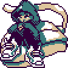

| Trainer | Team | Where |
|---|---|---|
| HIKIKOMORI | [PIKACHEWED](pokedex/025_PIKACHEWED.md) Lv81, [EMBRYEON](pokedex/196_EMBRYEON.md) Lv73, [PUTREFACTO](pokedex/143_PUTREFACTO.md) Lv75, [OPIUMZOR](pokedex/003_OPIUMZOR.md) Lv77, [LUCIFERION](pokedex/006_LUCIFERION.md) Lv77, [SCOLENE](pokedex/009_SCOLENE.md) Lv77 | Silver Cave |

## LEADER (BLUE)

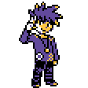

| Trainer | Team | Where |
|---|---|---|
| BLUE | [HEPOCORPS](pokedex/018_HEPOCORPS.md) Lv56, [MARTIRUS](pokedex/065_MARTIRUS.md) Lv54, [MEDUCUNT](pokedex/112_MEDUCUNT.md) Lv56, [HANNYADOS](pokedex/130_HANNYADOS.md) Lv58, [MASKABUKI](pokedex/103_MASKABUKI.md) Lv58, [BJORN](pokedex/059_BJORN.md) Lv58 | Viridian City Gym |

## OFFICER

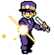

| Trainer | Team | Where |
|---|---|---|
| KEITH | [SCRATCHY](pokedex/058_SCRATCHY.md) Lv17 | Area 34 |
| DIRK | [SCRATCHY](pokedex/058_SCRATCHY.md) Lv14, [SCRATCHY](pokedex/058_SCRATCHY.md) Lv14 | Area 35 |

## ROCKET (POLICE)

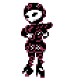

| Trainer | Team | Where |
|---|---|---|
| POLICE | [GOTCHICK](pokedex/041_GOTCHICK.md) Lv9, [ANFESIBO](pokedex/023_ANFESIBO.md) Lv11 | Slowpoke Well B1F |
| POLICE | [URBOROK](pokedex/024_URBOROK.md) Lv26 | Radio Tower 2F |
| POLICE | [INFECTO](pokedex/044_INFECTO.md) Lv25, [INFECTO](pokedex/044_INFECTO.md) Lv25 | Metro Complex |
| POLICE | [ANFESIBO](pokedex/023_ANFESIBO.md) Lv21, [ODDGLITCH](pokedex/043_ODDGLITCH.md) Lv23, [ANFESIBO](pokedex/023_ANFESIBO.md) Lv21, [INFECTO](pokedex/044_INFECTO.md) Lv24 | Radio Tower 4F |
| POLICE | [ANFESIBO](pokedex/023_ANFESIBO.md) Lv18, [INFECTO](pokedex/044_INFECTO.md) Lv18 | Lonely Woods B3F |

## MYSTICALMAN

| Trainer | Team | Where |
|---|---|---|
| EUSINE | [DUPUPETT](pokedex/096_DUPUPETT.md) Lv23, [WRAITARL](pokedex/093_WRAITARL.md) Lv23, [NINGOGORE](pokedex/101_NINGOGORE.md) Lv25 | Oversea Asylum |

